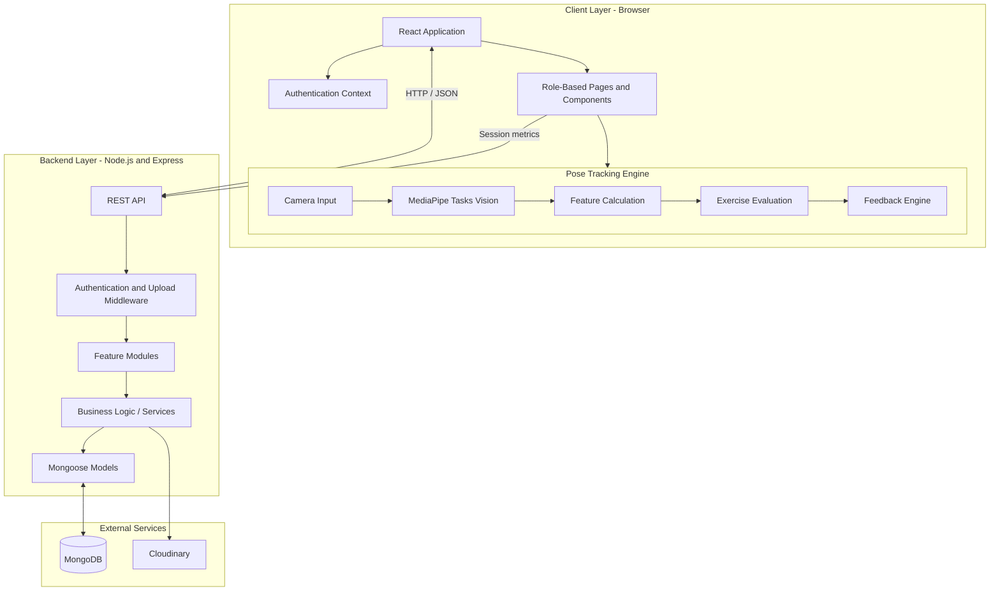
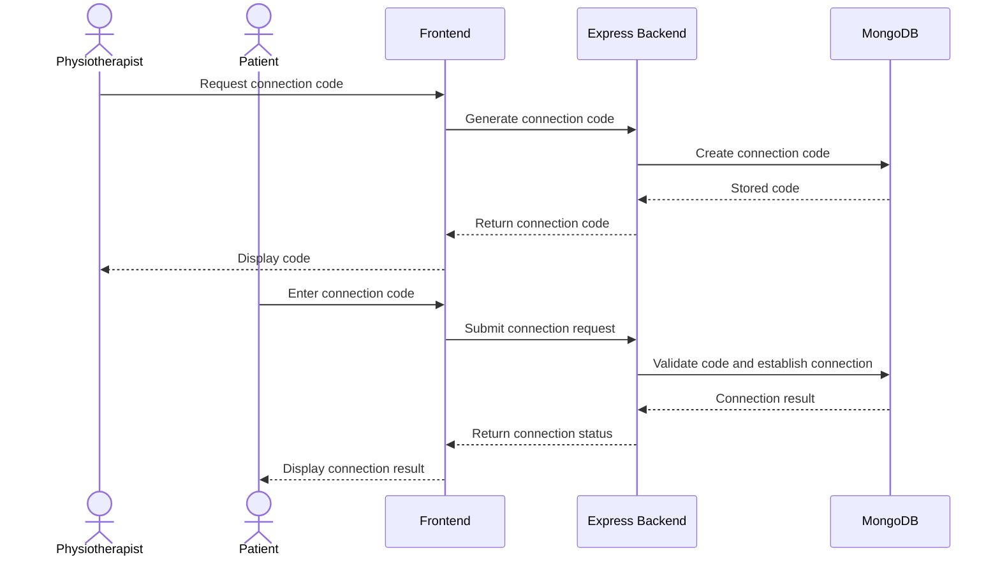
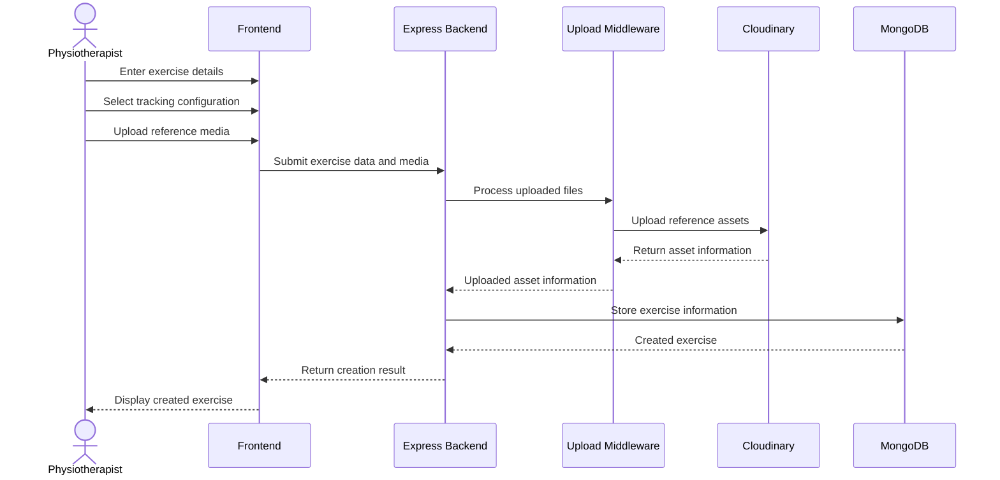
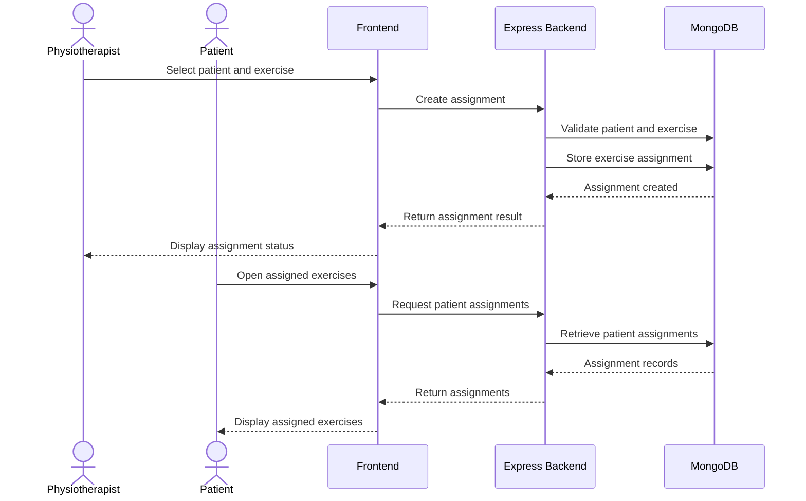
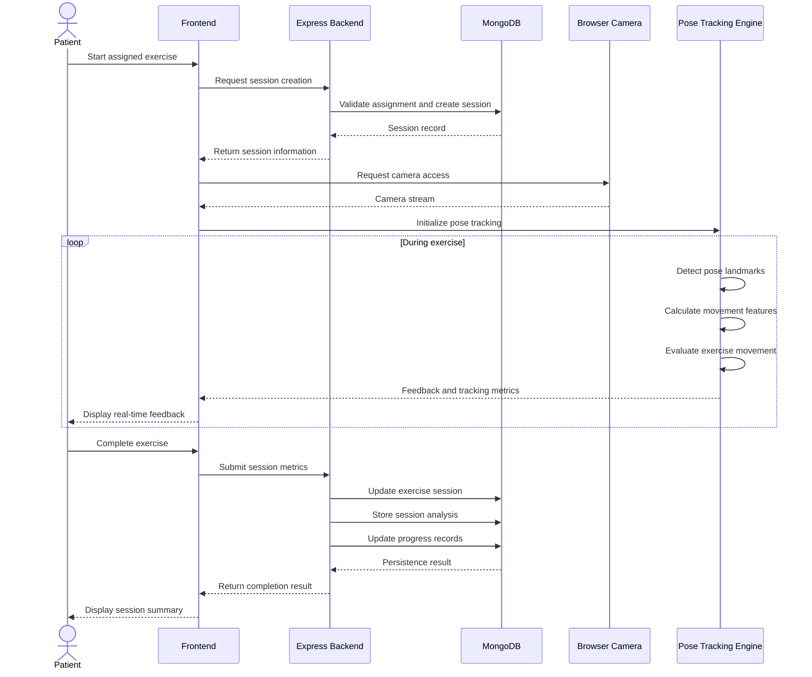
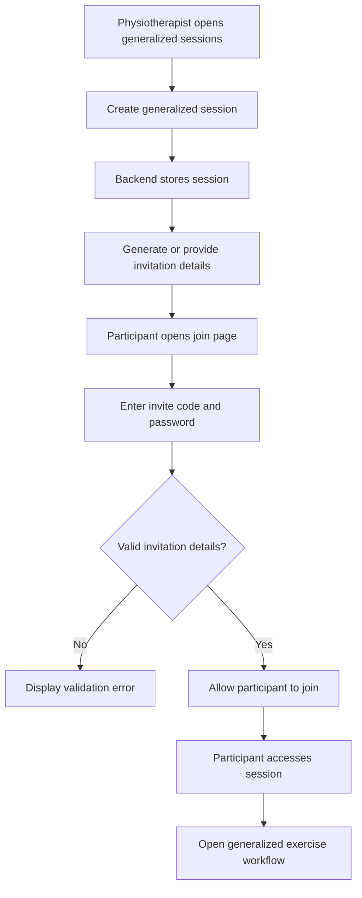
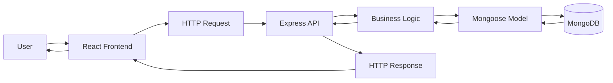
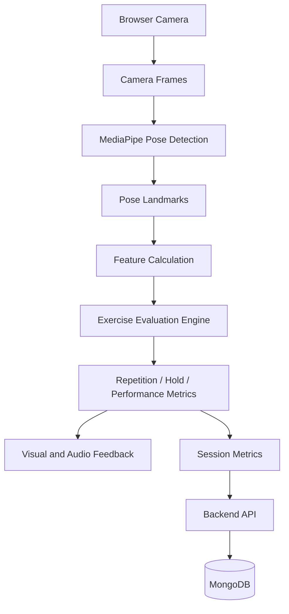
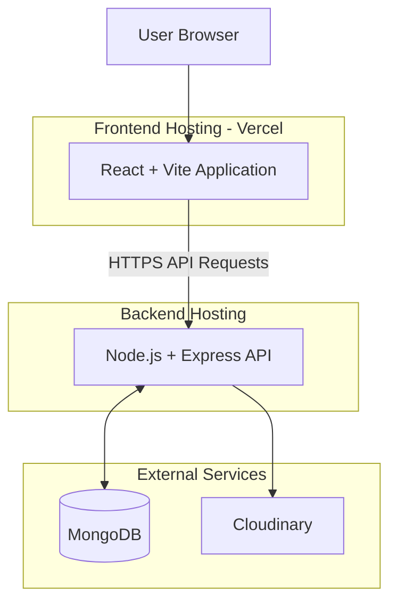

# System Architecture

## 1. Introduction

PhysioVision follows a client-server architecture consisting of a React-based frontend, a Node.js and Express backend, and a MongoDB database.

The application separates user interface responsibilities, business logic, data persistence, and browser-based pose tracking into distinct components.

The frontend communicates with the backend through REST APIs. The backend handles authentication, authorization, application workflows, and database operations. The pose-tracking engine runs independently in the browser and processes camera input locally.

This architecture allows computationally intensive pose processing to remain on the client side while keeping application data and business operations centralized on the backend.

## 2. Architectural Overview

The system can be divided into four primary layers:

1. **Presentation Layer:** React frontend responsible for user interfaces and application interactions.
2. **Application Layer:** Node.js and Express backend responsible for API handling and business logic.
3. **Data Layer:** MongoDB database accessed through Mongoose models.
4. **Pose-Tracking Layer:** Browser-based MediaPipe processing and exercise evaluation.

### 2.1 High-Level Architecture Diagram

## 3. Architectural Components

### 3.1 Frontend Application

**Technology:** React, Vite, JavaScript, Tailwind CSS v4

The frontend is the primary interaction layer for physiotherapists and patients.

It is responsible for rendering role-specific interfaces, managing authentication state, collecting user input, communicating with backend APIs, and displaying exercise performance information.

The frontend is organized into pages, reusable components, context providers, services, and exercise-tracking modules.

Its major responsibilities include:

- User registration and login.
- Role-specific dashboard rendering.
- Patient and physiotherapist connection workflows.
- Exercise browsing and custom exercise creation.
- Exercise assignment management.
- Exercise session execution.
- Camera access and pose tracking.
- Real-time exercise feedback.
- Session summaries and progress visualization.
- Generalized exercise session workflows.

The frontend communicates with the backend through centralized API service modules.

### 3.2 Backend Application

**Technology:** Node.js and Express.js

The backend exposes REST APIs consumed by the frontend.

It contains the application's business logic and coordinates operations involving authentication, users, patients, physiotherapists, exercises, assignments, sessions, and progress records.

The backend follows a modular structure in which related functionality is grouped into separate feature modules.

Its major responsibilities include:

- Handling incoming HTTP requests.
- Validating and authenticating requests.
- Enforcing role-based access.
- Managing patient–physiotherapist relationships.
- Creating and managing exercises.
- Managing exercise assignments.
- Starting and completing exercise sessions.
- Persisting session analysis.
- Updating patient progress records.
- Managing generalized exercise sessions.
- Handling reference media uploads.

The backend does not continuously process camera frames during the standard exercise-tracking workflow. Pose estimation and movement evaluation are performed in the browser.

### 3.3 Database Layer

**Technology:** MongoDB and Mongoose

MongoDB is used for persistent application storage.

Mongoose provides the data models and schema definitions used by the backend.

The database stores:

- User accounts.
- Patient profiles.
- Physiotherapist profiles.
- Patient connection codes.
- Exercise definitions.
- Exercise assignments.
- Exercise sessions.
- Session analysis.
- Patient progress records.
- Generalized exercise sessions.

The backend accesses the database through Mongoose models rather than allowing the frontend to communicate directly with MongoDB.

### 3.4 Pose-Tracking Engine

**Technology:** MediaPipe Tasks Vision and JavaScript

The pose-tracking engine is responsible for analyzing exercise movements using camera input.

It runs inside the browser and is integrated with the React application.

Its responsibilities include:

- Accessing camera input.
- Detecting body landmarks.
- Calculating movement-related features.
- Evaluating exercise-specific movement conditions.
- Tracking repetitions for supported dynamic exercises.
- Measuring hold duration for supported static poses.
- Generating feedback during exercise execution.
- Maintaining session-level performance metrics.

The tracking engine is separated from the backend because camera processing is performed locally in the browser.

The backend receives the resulting session information when the exercise session is submitted.

### 3.5 Cloudinary

Cloudinary is used for storing exercise reference media.

When a physiotherapist creates an exercise and uploads reference images or videos, the backend handles the upload workflow and stores the media using Cloudinary.

The application can then use the stored media as reference material for exercise-related workflows.

## 4. Frontend–Backend Communication

The frontend and backend communicate through HTTP-based REST APIs.

The frontend sends requests to the backend for operations that require authentication, business logic, or persistent storage.

Typical request categories include:

| Operation            | Frontend Responsibility                 | Backend Responsibility                         |
| -------------------- | --------------------------------------- | ---------------------------------------------- |
| Authentication       | Submit registration and login details   | Validate credentials and manage authentication |
| Patient connection   | Submit or generate connection codes     | Manage connection relationships                |
| Exercise management  | Display and submit exercise information | Create, retrieve, and manage exercises         |
| Exercise assignment  | Display assignment forms and lists      | Create and retrieve assignments                |
| Session management   | Initiate and complete sessions          | Persist session lifecycle information          |
| Session analysis     | Submit calculated metrics               | Store session analysis                         |
| Progress monitoring  | Display progress information            | Retrieve and aggregate progress records        |
| Generalized sessions | Create or join sessions                 | Manage session creation and participation      |

The frontend does not directly access the database or Cloudinary credentials.

All persistent application operations are handled through the backend.

## 5. Important Application Workflows

### 5.1 Authentication Workflow

```mermaid
sequenceDiagram
    actor User
    participant Frontend
    participant API as Express Backend
    participant Auth as Authentication Module
    participant DB as MongoDB

    User->>Frontend: Enter login credentials
    Frontend->>API: POST /api/auth/login
    API->>Auth: Process login request
    Auth->>DB: Find user
    DB-->>Auth: User information
    Auth->>Auth: Verify password
    Auth->>Auth: Generate authentication token
    Auth-->>API: Authentication result
    API-->>Frontend: Return authentication response
    Frontend->>Frontend: Update authentication state
    Frontend-->>User: Display role-specific application
```

The authentication workflow begins when a user submits login credentials through the frontend.

The backend validates the credentials, verifies the stored password hash, and generates an authentication token.

The frontend uses the authentication response to maintain the user's authenticated application state.

Subsequent protected API requests use the authentication mechanism implemented by the backend.

### 5.2 Patient–Physiotherapist Connection Workflow

The connection workflow allows patients and physiotherapists to establish a relationship through a generated code.

Once the connection is established, the backend uses the relationship when handling patient assignments and physiotherapist access to patient progress.

### 5.3 Exercise Creation Workflow

The frontend collects exercise details and optional reference media.

The backend processes the upload request, stores the media through Cloudinary, and persists the exercise information in MongoDB.

### 5.4 Exercise Assignment Workflow

The physiotherapist creates an assignment for a connected patient.

The backend stores the assignment and makes it available through the patient's assignment endpoint.

### 5.5 Exercise Session and Pose-Tracking Workflow

This is one of the most important workflows in PhysioVision because it combines backend session management with frontend-based movement evaluation.

The workflow is divided into two major phases.

**Phase 1: Session initialization**

1. The patient selects an assigned exercise.
2. The frontend requests session creation.
3. The backend validates the assignment.
4. The backend creates an exercise session.
5. The frontend receives the session information.
6. The browser requests camera access and initializes the tracking engine.

**Phase 2: Exercise execution and completion**

1. The tracking engine processes camera input.
2. MediaPipe detects pose landmarks.
3. The frontend calculates movement-related features.
4. Exercise-specific evaluation logic processes those features.
5. Feedback and metrics are updated during execution.
6. The frontend submits the final session metrics.
7. The backend updates the session record.
8. The backend stores session analysis.
9. The backend updates the patient's progress information.
10. The frontend displays the completed session summary.

The pose-tracking process does not require continuous communication with the backend. This keeps the real-time tracking workflow primarily client-side.

### 5.6 Generalized Exercise Session Workflow

Generalized sessions provide a separate participation workflow from individual patient exercise assignments.

The physiotherapist creates a session and shares its invitation details. Participants use the invitation workflow to access the session.

## 6. Data Flow Architecture

PhysioVision uses different data flows depending on the operation being performed.

### 6.1 Standard Application Data Flow

This flow is used for authentication, patient management, exercise management, assignments, session management, and progress retrieval.

### 6.2 Pose-Tracking Data Flow

The pose-tracking data flow is primarily executed inside the browser.

The backend receives the resulting session information when the frontend submits the exercise metrics.

## 7. Architectural Design Principles

### 7.1 Separation of Responsibilities

The frontend, backend, database, and pose-tracking engine have separate responsibilities.

This separation makes it easier to maintain application features independently.

For example, exercise evaluation logic can be modified without requiring the backend to process camera frames.

### 7.2 Modular Backend

Backend functionality is divided into feature-based modules.

Authentication, exercise management, assignments, connections, sessions, progress, physiotherapist operations, and generalized sessions are maintained as separate functional areas.

This structure helps keep related business logic together.

### 7.3 Client-Side Pose Processing

Pose estimation and exercise evaluation are performed in the browser.

This avoids sending continuous camera frames to the backend during the standard tracking workflow and reduces the need for server-side video processing.

### 7.4 Centralized Data Management

Persistent application data is managed through the backend and MongoDB.

The frontend communicates through APIs instead of accessing the database directly.

### 7.5 Role-Based Access

The application provides different workflows for physiotherapists and patients.

The backend also performs authorization checks for protected operations, helping prevent users from accessing resources outside their permitted scope.

## 8. Deployment Architecture

The frontend is deployed on Vercel.

The backend runs as a separate Node.js and Express application and connects to MongoDB. Cloudinary is used for reference media storage.

The deployment architecture can be represented as follows:

### 8.1 Frontend Deployment

The frontend is built using Vite and deployed on Vercel.

The deployed application is available at:

https://pvv-3.vercel.app/

The frontend includes a Vercel rewrite configuration to support client-side routing.

This ensures that direct navigation to application routes, such as nested dashboard pages, returns the frontend entry point instead of a server-side 404 response.

### 8.2 Backend Deployment

The backend is deployed separately from the frontend.

It provides the REST API used by the React application.

The backend requires environment-specific configuration for database connectivity, authentication, and media uploads.

### 8.3 Database and Media Storage

MongoDB provides persistent application storage.

Cloudinary handles uploaded exercise reference media.

The backend is responsible for communicating with both services.

## 9. Architecture Limitations and Considerations

The architecture has several practical considerations.

### 9.1 Browser and Camera Dependency

The pose-tracking engine depends on browser camera access.

Users must grant camera permission, and tracking quality can vary depending on lighting, camera positioning, device performance, and body visibility.

### 9.2 Client-Side Processing

Since pose processing runs in the browser, the device's processing capability can influence tracking performance.

The application does not rely on the backend for continuous camera-frame processing.

### 9.3 Exercise-Specific Evaluation

Different exercises can require different movement conditions and evaluation logic.

The tracking engine must use the appropriate configuration and evaluation process for the selected exercise.

### 9.4 Clinical Interpretation

The application generates exercise-related measurements and feedback.

These outputs are intended to support monitoring and should not be interpreted as medical diagnoses or definitive clinical assessments.

### 9.5 Network Dependency

Operations involving authentication, assignments, session persistence, and progress retrieval require backend connectivity.

Pose tracking can execute locally, but saving completed session information requires communication with the backend.

## 10. Summary

PhysioVision uses a modular client-server architecture with browser-based pose processing.

The React frontend handles user interaction, application workflows, and exercise tracking. The Node.js and Express backend manages business logic, authentication, and persistent operations. MongoDB stores application data, while Cloudinary stores exercise reference media.

A key architectural decision is keeping the pose-tracking workflow on the client side. Camera frames are processed in the browser, and the backend receives the resulting session metrics rather than continuous raw camera input.

This separation allows PhysioVision to combine exercise management, patient monitoring, and real-time movement feedback within a single web application.
