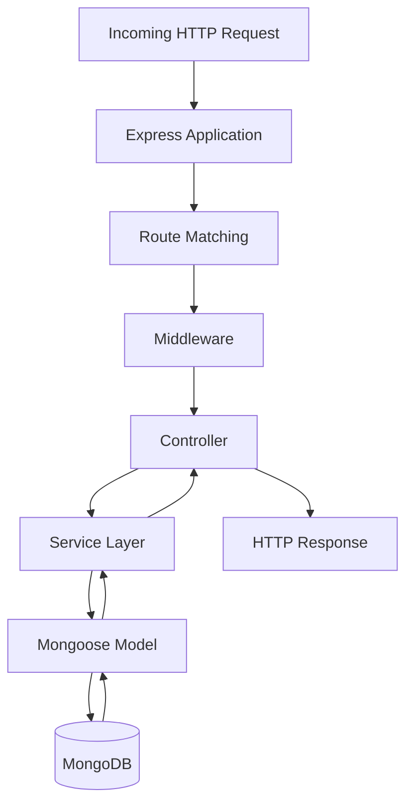
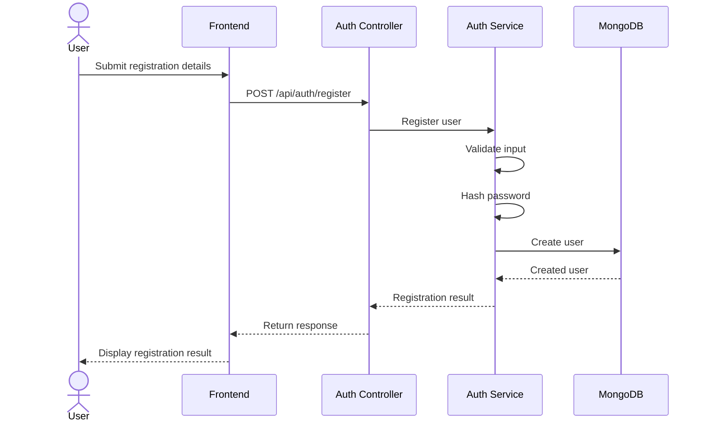
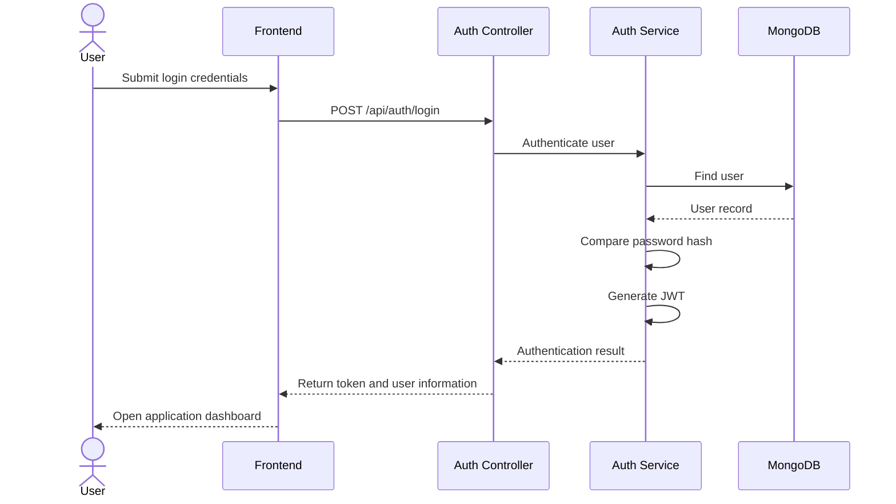
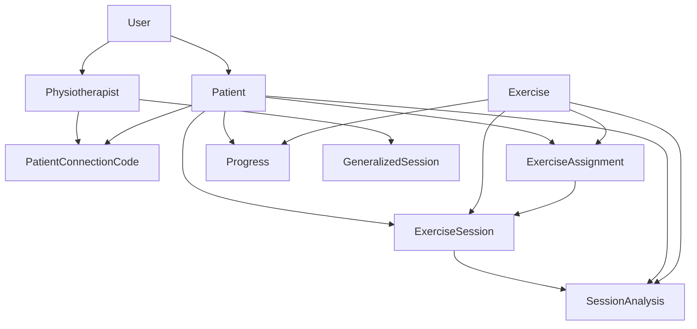

# Backend Architecture

## 1. Introduction

The PhysioVision backend is built using Node.js and Express.js. It provides the REST API layer responsible for authentication, authorization, application workflows, business logic, and persistent data management.

The backend follows a modular architecture in which related functionality is organized into separate feature modules. Each module handles a specific domain, such as authentication, exercise management, patient connections, assignments, sessions, or progress monitoring.

MongoDB is used as the primary database, with Mongoose providing schema definitions and database operations.

The backend also integrates with Cloudinary for storing exercise reference images and videos.

## 2. Backend Technology Stack

| Technology | Purpose                            |
| ---------- | ---------------------------------- |
| Node.js    | Server-side JavaScript runtime     |
| Express.js | HTTP server and REST API framework |
| MongoDB    | Persistent data storage            |
| Mongoose   | MongoDB object modeling            |
| JWT        | Token-based authentication         |
| bcrypt     | Password hashing                   |
| Cloudinary | Exercise reference media storage   |
| Multer     | Handling multipart file uploads    |

## 3. Backend Directory Structure

The backend follows a feature-oriented structure.

```text
backend/
│
├── src/
│   │
│   ├── config/
│   │   ├── cloudinary.js
│   │   └── db.js
│   │
│   ├── middleware/
│   │   ├── auth.js
│   │   └── uploadExerciseAssets.js
│   │
│   ├── models/
│   │   ├── Exercise.js
│   │   ├── ExerciseAssignment.js
│   │   ├── ExerciseSession.js
│   │   ├── GeneralizedSession.js
│   │   ├── Patient.js
│   │   ├── PatientConnectionCode.js
│   │   ├── Physiotherapist.js
│   │   ├── Progress.js
│   │   ├── SessionAnalysis.js
│   │   └── User.js
│   │
│   ├── modules/
│   │   ├── assignment/
│   │   ├── auth/
│   │   ├── connections/
│   │   ├── exercise/
│   │   ├── generalizedSessions/
│   │   ├── physio/
│   │   ├── progress/
│   │   └── session/
│   │
│   ├── utils/
│   │   └── uploadToCloudinary.js
│   │
│   ├── app.js
│   └── server.js
│
├── package.json
└── package-lock.json
```

### 3.1 Configuration

The `config/` directory contains configuration modules required by the backend.

**`db.js`**

Responsible for establishing the MongoDB connection.

**`cloudinary.js`**

Contains the Cloudinary configuration used for exercise reference media storage.

### 3.2 Middleware

The `middleware/` directory contains reusable request-processing logic.

**`auth.js`**

Handles authentication and authorization for protected API routes.

It is responsible for validating the authentication token and making authenticated user information available to downstream route handlers.

**`uploadExerciseAssets.js`**

Handles multipart upload processing for exercise reference assets.

It supports the exercise creation workflow involving reference images and videos.

### 3.3 Models

The `models/` directory contains Mongoose schemas and models.

Each model represents a persistent entity used by the application.

| Model                      | Responsibility                                             |
| -------------------------- | ---------------------------------------------------------- |
| `User.js`                  | Stores user account and authentication information         |
| `Patient.js`               | Stores patient-specific profile information                |
| `Physiotherapist.js`       | Stores physiotherapist-specific profile information        |
| `PatientConnectionCode.js` | Manages patient connection codes                           |
| `Exercise.js`              | Stores exercise definitions and configurations             |
| `ExerciseAssignment.js`    | Represents exercises assigned to patients                  |
| `ExerciseSession.js`       | Stores individual exercise session information             |
| `SessionAnalysis.js`       | Stores analysis results associated with completed sessions |
| `Progress.js`              | Maintains aggregated patient exercise progress             |
| `GeneralizedSession.js`    | Stores generalized exercise session information            |

### 3.4 Modules

The `modules/` directory contains the main business functionality.

Each module groups related backend operations and separates feature-specific implementation from the application entry point.

The modules include:

- Authentication.
- Patient connections.
- Exercise management.
- Exercise assignments.
- Physiotherapist operations.
- Exercise sessions.
- Patient progress.
- Generalized exercise sessions.

### 3.5 Utilities

The `utils/` directory contains reusable helper functions.

**`uploadToCloudinary.js`**

Provides reusable functionality for uploading exercise reference assets to Cloudinary.

### 3.6 Application Entry Points

**`app.js`**

Responsible for configuring the Express application, registering middleware, and mounting API routes.

**`server.js`**

Responsible for starting the backend server and initializing the application runtime.

## 4. Backend Request Lifecycle

The backend follows a layered request-processing flow.



The typical request lifecycle is:

1. The frontend sends an HTTP request.
2. Express receives the request.
3. The router identifies the matching endpoint.
4. Middleware performs required request processing, such as authentication or file upload handling.
5. The controller handles the incoming request.
6. The service layer executes the relevant business logic.
7. Mongoose models interact with MongoDB.
8. The service returns the operation result.
9. The controller sends the appropriate HTTP response.

This separation keeps HTTP handling, business logic, and database operations organized.

## 5. Feature Modules

### 5.1 Authentication Module

**Directory:** `modules/auth/`

The authentication module handles user registration, login, and authenticated user information.

Its main responsibilities include:

- Registering new users.
- Validating login credentials.
- Hashing passwords before storing them.
- Verifying passwords during login.
- Generating JWT authentication tokens.
- Returning authenticated user information.

The authentication module works with the `User` model and the authentication middleware.

#### Registration Workflow



#### Login Workflow



### 5.2 Connections Module

**Directory:** `modules/connections/`

The connections module manages the relationship between patients and physiotherapists.

Its main responsibilities include:

- Generating patient connection codes.
- Validating submitted connection codes.
- Establishing patient–physiotherapist relationships.
- Retrieving the patient's existing connection information.

The module works with the `PatientConnectionCode`, `Patient`, and `Physiotherapist` models.

#### Connection Workflow

1. A physiotherapist requests a connection code.
2. The backend generates and stores the code.
3. The code is returned to the physiotherapist.
4. A patient submits the code.
5. The backend validates the code.
6. The patient–physiotherapist relationship is established.
7. The resulting connection can be retrieved through the connection APIs.

### 5.3 Exercise Module

**Directory:** `modules/exercise/`

The exercise module manages the exercise definitions used throughout the application.

Its responsibilities include:

- Retrieving available exercises.
- Retrieving an individual exercise.
- Creating custom exercises.
- Storing exercise configuration.
- Handling reference media information.

The module uses the `Exercise` model.

Exercise information can include:

- Name.
- Description.
- Category.
- Tracking mode.
- Target hold duration.
- Matching threshold.
- Exercise-specific configuration.
- Reference image information.
- Reference video information.

Reference media is processed through the upload middleware and stored using Cloudinary.

### 5.4 Assignment Module

**Directory:** `modules/assignment/`

The assignment module manages the relationship between exercises and patients.

Its responsibilities include:

- Creating exercise assignments.
- Retrieving assignments for a patient.
- Retrieving assignments created by a physiotherapist.
- Managing assignment status.

The module uses the `ExerciseAssignment` model and interacts with patient and exercise records.

An assignment associates a patient with an exercise and can contain a target repetition count.

When a patient starts an assigned exercise, the assignment status is updated to `IN_PROGRESS`.

### 5.5 Session Module

**Directory:** `modules/session/`

The session module manages individual patient exercise sessions.

It handles session initialization, completion, and persistence of exercise performance information.

Its responsibilities include:

- Starting a session from an exercise assignment.
- Validating that the assignment belongs to the requesting patient.
- Creating an exercise session record.
- Completing an exercise session.
- Storing session performance metrics.
- Creating or updating session analysis.
- Updating aggregated progress information.

The module interacts with the following models:

- `ExerciseSession`
- `ExerciseAssignment`
- `Patient`
- `SessionAnalysis`
- `Progress`

#### Session Initialization

When a patient starts an exercise, the backend first identifies the patient's profile.

It then verifies that the requested assignment belongs to that patient and retrieves the associated exercise.

The backend creates an `ExerciseSession` record containing:

- Patient reference.
- Exercise reference.
- Assignment reference.
- Start timestamp.
- Target repetitions.

The assignment status is then updated to `IN_PROGRESS`.

#### Session Completion

When the frontend submits the completed exercise metrics, the backend:

1. Identifies the patient associated with the authenticated user.
2. Retrieves the requested session while checking patient ownership.
3. Updates the completion timestamp.
4. Stores session duration.
5. Stores completed repetitions.
6. Stores average score and repetition-level scores.
7. Marks the session as `COMPLETED`.
8. Creates or updates the corresponding session analysis.
9. Updates the patient's aggregated progress record.

The backend does not perform the pose estimation itself. The frontend submits the calculated session metrics.

### 5.6 Progress Module

**Directory:** `modules/progress/`

The progress module provides access to patient exercise progress and completed session history.

Its responsibilities include:

- Retrieving patient progress records.
- Retrieving completed exercise sessions.
- Checking physiotherapist access to patient records.
- Returning exercise-related progress information.

The module uses the `Progress`, `Patient`, `Physiotherapist`, and `ExerciseSession` models.

#### Patient Access Verification

The progress service verifies whether the requesting physiotherapist is authorized to access the specified patient.

The access verification checks the patient's physiotherapist relationship and also resolves the physiotherapist profile where necessary.

This ensures that progress information is not retrieved solely by trusting a patient identifier supplied in the request.

### 5.7 Physiotherapist Module

**Directory:** `modules/physio/`

The physiotherapist module handles physiotherapist-specific operations.

Its responsibilities include retrieving the patients associated with a physiotherapist and providing the data required by the physiotherapist dashboard.

The module works with the `Physiotherapist` and `Patient` models.

### 5.8 Generalized Sessions Module

**Directory:** `modules/generalizedSessions/`

The generalized sessions module manages exercise sessions that participants can join through an invitation workflow.

Its responsibilities include:

- Creating generalized sessions.
- Retrieving sessions created by a physiotherapist.
- Updating session status.
- Retrieving session information using an invite code.
- Validating participant join requests.
- Managing the join workflow.

The module uses the `GeneralizedSession` model.

Unlike individual exercise assignments, generalized sessions provide a separate mechanism for organizing participation through invitation details.

## 6. Middleware Architecture

Middleware functions are executed during the request lifecycle before the relevant controller logic.

PhysioVision uses middleware for authentication and exercise asset uploads.

### 6.1 Authentication Middleware

**File:** `src/middleware/auth.js`

The authentication middleware protects routes that require an authenticated user.

Its general responsibilities include:

1. Extracting the authentication token from the request.
2. Validating the token.
3. Identifying the authenticated user.
4. Making authenticated user information available to subsequent request handlers.
5. Rejecting requests with missing or invalid authentication credentials.

Protected routes can also enforce role-specific access requirements.

### 6.2 Exercise Upload Middleware

**File:** `src/middleware/uploadExerciseAssets.js`

The upload middleware handles multipart form data for exercise reference assets.

It is used in the custom exercise creation workflow.

The upload process allows the backend to receive reference images and videos before the exercise information is persisted.

### 6.3 Cloudinary Upload Utility

**File:** `src/utils/uploadToCloudinary.js`

The Cloudinary utility provides reusable upload functionality.

The backend uses it to store exercise reference media externally instead of storing the uploaded media files directly in MongoDB.

MongoDB stores the corresponding exercise information and media references.

## 7. Database Interaction

The backend uses Mongoose models to interact with MongoDB.

The models represent the application's main entities and define the relationships between them.

### 7.1 Model Interaction Overview



The diagram represents the major logical relationships. Exact field names, cardinalities, and schema constraints are documented separately in `05-database-design.md`.

### 7.2 Session Analysis Persistence

Session analysis is stored separately from the main exercise session record.

The `SessionAnalysis` model contains:

| Field             | Purpose                                      |
| ----------------- | -------------------------------------------- |
| `session`         | Reference to the associated exercise session |
| `patient`         | Reference to the patient                     |
| `exercise`        | Reference to the exercise                    |
| `accuracy`        | Accuracy score                               |
| `formConsistency` | Form consistency score                       |
| `completedReps`   | Number of completed repetitions              |
| `averageRepScore` | Average repetition score                     |
| `summary`         | Session analysis summary                     |

The session reference is unique, ensuring that a session has a single associated analysis record.

The backend uses an upsert operation during session completion. This creates the analysis record when it does not exist or updates the existing record.

### 7.3 Aggregated Progress

The `Progress` model stores aggregated exercise progress for patients.

When a session is completed, the session service finds the corresponding progress record using the patient and exercise relationship.

If a record exists, it is updated. Otherwise, a new progress record is created.

This allows the application to maintain progress information across multiple exercise sessions without relying exclusively on individual session records.

## 8. API Route Organization

The backend exposes REST endpoints grouped by functional domain.

The following table summarizes the known API routes.

### 8.1 Authentication Routes

| Method | Endpoint             | Purpose                                 | Access        |
| ------ | -------------------- | --------------------------------------- | ------------- |
| POST   | `/api/auth/register` | Register a user                         | Public        |
| POST   | `/api/auth/login`    | Authenticate a user                     | Public        |
| GET    | `/api/auth/me`       | Retrieve authenticated user information | Authenticated |

### 8.2 Connection and Physiotherapist Routes

| Method | Endpoint                   | Purpose                            | Access          |
| ------ | -------------------------- | ---------------------------------- | --------------- |
| GET    | `/api/physio/patients`     | Retrieve physiotherapist patients  | Physiotherapist |
| POST   | `/api/connections/code`    | Generate a patient connection code | Physiotherapist |
| POST   | `/api/connections/connect` | Connect a patient using a code     | Patient         |
| GET    | `/api/connections/mine`    | Retrieve the patient's connection  | Patient         |

### 8.3 Exercise Routes

| Method | Endpoint             | Purpose                         | Access                            |
| ------ | -------------------- | ------------------------------- | --------------------------------- |
| GET    | `/api/exercises`     | Retrieve available exercises    | As configured by route middleware |
| GET    | `/api/exercises/:id` | Retrieve an individual exercise | As configured by route middleware |
| POST   | `/api/exercises`     | Create a custom exercise        | Physiotherapist                   |

### 8.4 Assignment Routes

| Method | Endpoint                  | Purpose                              | Access          |
| ------ | ------------------------- | ------------------------------------ | --------------- |
| POST   | `/api/assignments`        | Create an exercise assignment        | Physiotherapist |
| GET    | `/api/assignments/my`     | Retrieve patient assignments         | Patient         |
| GET    | `/api/assignments/physio` | Retrieve physiotherapist assignments | Physiotherapist |

### 8.5 Session Routes

| Method | Endpoint                     | Purpose                          | Access  |
| ------ | ---------------------------- | -------------------------------- | ------- |
| POST   | `/api/sessions/start`        | Start an exercise session        | Patient |
| PATCH  | `/api/sessions/:id/complete` | Complete an exercise session     | Patient |
| GET    | `/api/sessions/my`           | Retrieve patient session history | Patient |

### 8.6 Progress Routes

| Method | Endpoint                                    | Purpose                                     | Access                              |
| ------ | ------------------------------------------- | ------------------------------------------- | ----------------------------------- |
| GET    | `/api/progress/patient/:patientId`          | Retrieve patient progress                   | Authorized access                   |
| GET    | `/api/progress/patient/:patientId/sessions` | Retrieve patient session history for review | Physiotherapist with patient access |

### 8.7 Generalized Session Routes

| Method | Endpoint                                     | Purpose                                          | Access          |
| ------ | -------------------------------------------- | ------------------------------------------------ | --------------- |
| POST   | `/api/generalized-sessions`                  | Create a generalized session                     | Physiotherapist |
| GET    | `/api/generalized-sessions/mine`             | Retrieve sessions created by the physiotherapist | Physiotherapist |
| PATCH  | `/api/generalized-sessions/:id/status`       | Update generalized session status                | Physiotherapist |
| GET    | `/api/generalized-sessions/join/:inviteCode` | Retrieve session information for joining         | Public          |
| POST   | `/api/generalized-sessions/join/:inviteCode` | Join a generalized session                       | Public          |

### 8.8 Health Route

| Method | Endpoint      | Purpose                            |
| ------ | ------------- | ---------------------------------- |
| GET    | `/api/health` | Check backend service availability |

> **Note:** This table is a high-level route inventory. Exact request bodies, response structures, validation rules, and status codes should be documented from the corresponding route and controller implementations in `06-api-reference.md`.

## 9. Error Handling and Validation

The backend must handle invalid requests, authentication failures, missing resources, and database errors.

Important validation scenarios include:

- Missing registration or login information.
- Invalid authentication tokens.
- Incorrect login credentials.
- Invalid patient connection codes.
- Missing patient or physiotherapist profiles.
- Assignments that do not belong to the requesting patient.
- Invalid exercise identifiers.
- Missing exercise session records.
- Unauthorized access to patient progress.
- Invalid or incomplete exercise upload requests.
- Invalid generalized session invitation details.

For example, the session creation service checks whether the authenticated user has a patient profile and whether the requested assignment belongs to that patient before creating an exercise session.

Similarly, session completion retrieves the session using both the session identifier and the patient's identifier. This prevents a patient from completing another patient's session by supplying an arbitrary session ID.

## 10. Security Considerations

The backend implements authentication and role-specific access controls.

Important security responsibilities include:

### 10.1 Password Protection

Passwords are hashed using bcrypt before being stored.

Plain-text passwords should never be stored in the database.

### 10.2 Token-Based Authentication

JWT is used to authenticate protected API requests.

The backend validates the token before allowing access to protected operations.

### 10.3 Role-Based Authorization

Operations are restricted according to the user's role.

For example:

- Physiotherapists can create exercises and assign them to patients.
- Patients can access their own assignments and exercise sessions.
- Physiotherapists can access progress information for patients they are authorized to manage.

### 10.4 Resource-Level Authorization

Authentication alone is not sufficient to access every resource.

The backend also checks relationships between users and application records.

For example, session creation validates assignment ownership, and session completion validates session ownership.

### 10.5 Environment Configuration

Sensitive configuration values should be maintained in environment variables rather than committed to the source repository.

Typical configuration includes:

- MongoDB connection string.
- JWT secret.
- Cloudinary credentials.
- Server port.
- Other deployment-specific settings.

The actual variable names and required values should be maintained in the deployment documentation.

## 11. External Service Integration

### 11.1 MongoDB

MongoDB is the primary persistent storage system.

The backend establishes a database connection through the configuration module and accesses application data through Mongoose models.

### 11.2 Cloudinary

Cloudinary stores uploaded exercise reference media.

The backend handles the upload process and stores the resulting media references with the corresponding exercise information.

The frontend accesses the stored media through the references returned by the backend.

## 12. Backend Design Decisions

### 12.1 Modular Feature Organization

The backend groups related functionality into separate modules.

This keeps authentication, connections, exercises, assignments, sessions, and progress management logically separated.

### 12.2 Separation of Controllers and Services

HTTP request handling is separated from business logic.

Controllers handle request and response operations, while services perform the core application operations.

This improves code organization and makes business logic easier to maintain.

### 12.3 Mongoose-Based Data Access

Database operations are performed through Mongoose models.

This provides a structured way to define schemas, validate data, and manage relationships between application entities.

### 12.4 Separate Session and Analysis Records

Exercise session information and its performance analysis are maintained as separate records.

This separates session lifecycle information from the analysis generated after exercise completion.

### 12.5 Client-Side Exercise Evaluation

The backend does not continuously process camera frames.

Pose detection, movement feature calculation, and real-time feedback remain in the frontend. The backend focuses on session lifecycle management and persistence of calculated metrics.

### 12.6 External Media Storage

Exercise reference images and videos are stored using Cloudinary rather than being embedded directly in MongoDB documents.

This keeps media storage separate from application data storage.

## 13. Summary

The PhysioVision backend uses a modular Node.js and Express architecture with MongoDB as its primary database.

The backend is divided into configuration, middleware, models, feature modules, and utility functions.

Each feature module handles a specific application domain:

- Authentication manages user registration and login.
- Connections manage patient–physiotherapist relationships.
- Exercises manage exercise definitions and reference media.
- Assignments manage patient exercise assignments.
- Sessions manage exercise session creation and completion.
- Progress provides patient performance history.
- Physiotherapist operations support patient management.
- Generalized sessions manage invitation-based exercise participation.

The backend also integrates with Cloudinary for media storage and uses JWT and bcrypt for authentication-related operations.

A key architectural responsibility is maintaining the boundary between browser-based exercise evaluation and server-side application management. The frontend processes camera input and calculates exercise metrics, while the backend validates, stores, and retrieves the resulting application data.
