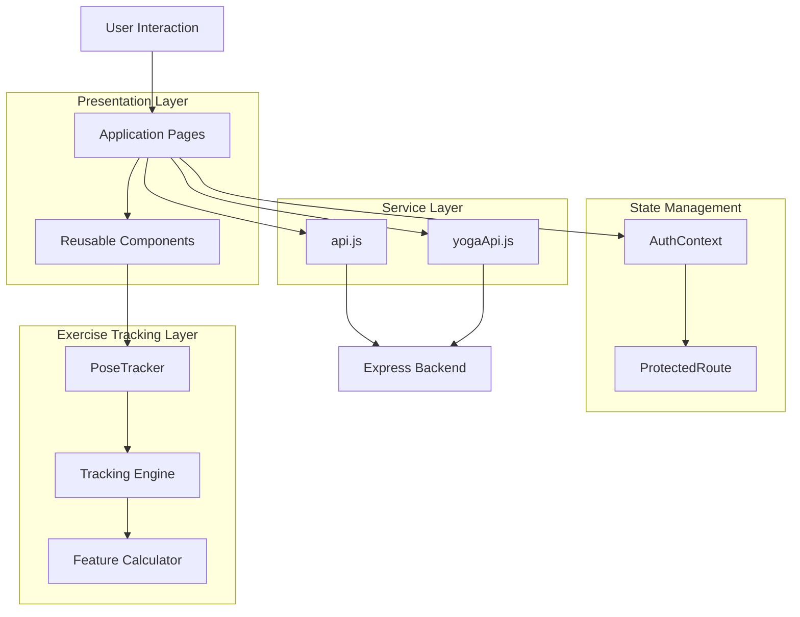
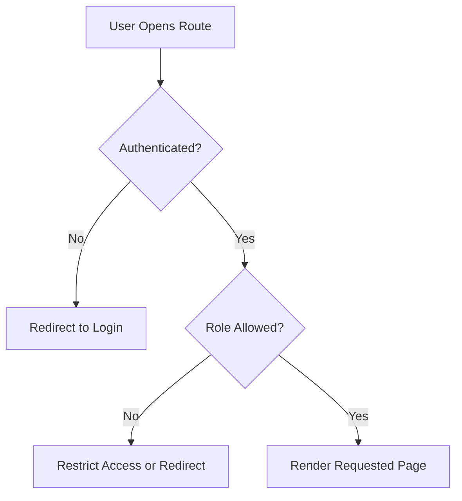
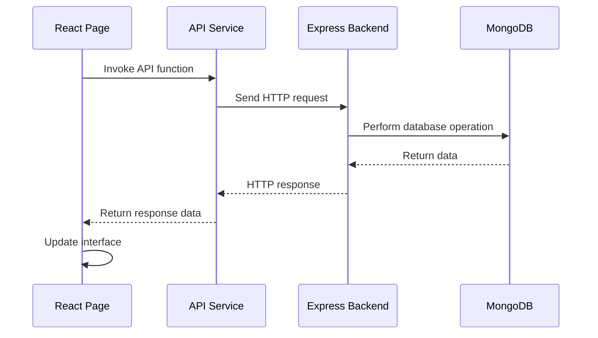
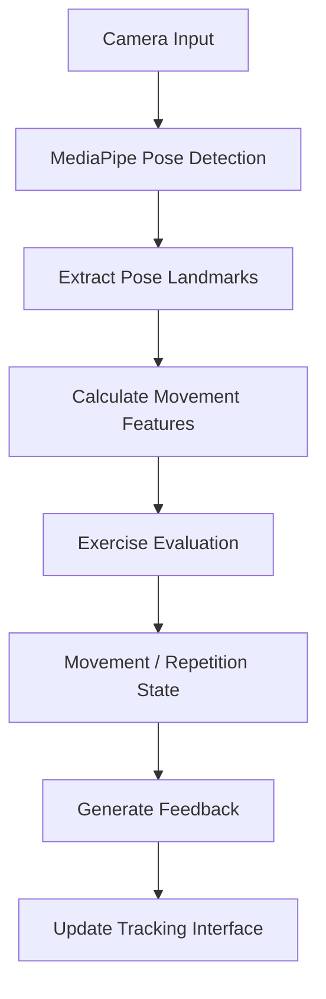
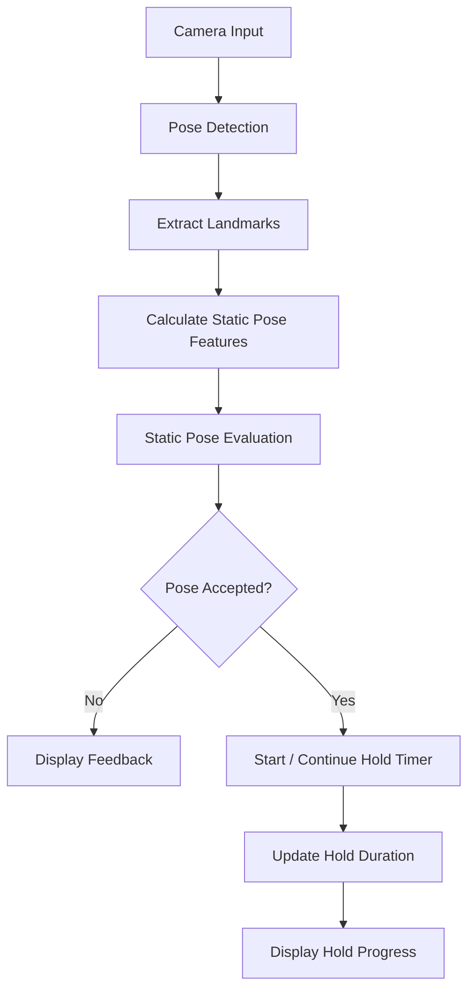
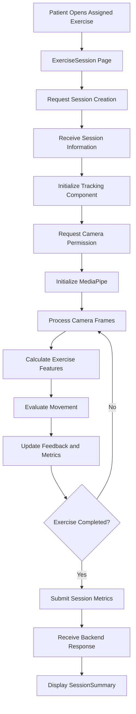

# Frontend Architecture

## 1. Introduction

The PhysioVision frontend is built using React, Vite, JavaScript, and Tailwind CSS v4.

It is responsible for providing the user interface for physiotherapists and patients, managing authentication state, communicating with backend APIs, and executing browser-based exercise tracking.

The frontend follows a component-based architecture. Pages represent application screens, reusable components handle common interface functionality, context manages shared application state, and service modules centralize backend communication.

A separate exercise-tracking engine handles pose detection, movement feature calculation, exercise evaluation, and feedback generation.

The frontend is designed around two primary user roles:

- **Physiotherapist:** Manages patients, creates exercises, assigns routines, and monitors patient progress.
- **Patient:** Views assigned exercises, performs exercise sessions, and reviews personal progress.

## 2. Frontend Technology Stack

| Technology             | Purpose                                       |
| ---------------------- | --------------------------------------------- |
| React                  | Component-based user interface development    |
| Vite                   | Frontend development server and build tooling |
| JavaScript             | Application logic and component behavior      |
| Tailwind CSS v4        | Utility-based styling                         |
| React Router           | Client-side navigation                        |
| Context API            | Shared authentication state                   |
| MediaPipe Tasks Vision | Browser-based pose estimation                 |
| Fetch API              | Communication with backend services           |

## 3. Frontend Directory Structure

The frontend follows a feature-oriented structure with separate directories for components, pages, context, services, and exercise-tracking logic.

```text
frontend/
│
├── public/
│   ├── icons.svg
│   └── pvv3.png
│
├── src/
│   │
│   ├── components/
│   │   ├── AddPatient.jsx
│   │   ├── ConnectPhysio.jsx
│   │   ├── ExerciseReferenceMedia.jsx
│   │   ├── PoseTracker.jsx
│   │   ├── ProtectedRoute.jsx
│   │   ├── SessionDetailReport.jsx
│   │   ├── StaticYogaHoldPanel.jsx
│   │   ├── StaticYogaPoseTracker.jsx
│   │   └── YogaExerciseCreator.jsx
│   │
│   ├── context/
│   │   └── AuthContext.jsx
│   │
│   ├── engine/
│   │   ├── Calibrator.js
│   │   ├── DTWMatcher.js
│   │   ├── FeedbackEngine.js
│   │   ├── geometry.js
│   │   ├── ReferenceImageCalibrator.js
│   │   ├── ReferenceVideoCalibrator.js
│   │   ├── ROMJudge.js
│   │   ├── StaticHoldTimer.js
│   │   └── StaticPoseJudge.js
│   │
│   ├── exercise/
│   │   └── featureCalculator.js
│   │
│   ├── pages/
│   │   ├── CustomExercise.jsx
│   │   ├── ExerciseSession.jsx
│   │   ├── GeneralizedSessionExercise.jsx
│   │   ├── GeneralizedSessions.jsx
│   │   ├── JoinGeneralizedSession.jsx
│   │   ├── Login.jsx
│   │   ├── PatientDashboard.jsx
│   │   ├── PatientProgress.jsx
│   │   ├── PhysioDashboard.jsx
│   │   ├── ReferenceVideoCalibrator.jsx
│   │   ├── Register.jsx
│   │   └── SessionSummary.jsx
│   │
│   ├── services/
│   │   ├── api.js
│   │   └── yogaApi.js
│   │
│   ├── App.css
│   ├── App.jsx
│   ├── index.css
│   └── main.jsx
│
├── index.html
├── package.json
├── vite.config.js
└── vercel.json
```

## 4. Application Entry Points

### 4.1 `main.jsx`

`main.jsx` is the frontend entry point.

It initializes the React application and renders the root application component.

### 4.2 `App.jsx`

`App.jsx` acts as the main application component.

It organizes application routing and connects the different pages and shared application components.

It is responsible for defining the navigation structure between authentication pages, dashboards, exercise workflows, and other application screens.

### 4.3 `App.css` and `index.css`

These files contain application-level styling.

They provide the styling foundation used throughout the frontend.

### 4.4 `vite.config.js`

The Vite configuration defines the frontend build and development environment.

### 4.5 `vercel.json`

The Vercel configuration contains the rewrite rule used to support client-side routing after deployment.

```json
{
    "rewrites": [
        {
            "source": "/(.*)",
            "destination": "/index.html"
        }
    ]
}
```

This ensures that direct navigation to nested frontend routes returns the React application entry point.

Without this rewrite, refreshing or directly opening a nested route can result in a server-side 404 response because the route is handled by React Router rather than an independently hosted backend page.

## 5. Frontend Architectural Layers

The frontend can be divided into five logical layers.



### 5.1 Presentation Layer

Contains application pages and reusable React components.

It handles:

- Rendering dashboards.
- Displaying exercise information.
- Collecting user input.
- Displaying patient and physiotherapist information.
- Showing exercise feedback.
- Displaying session summaries and progress reports.

### 5.2 State Management Layer

The Context API is used for shared authentication state.

It allows different components to access the current authentication information without passing the same information through multiple levels of component props.

Protected routes use authentication and role information to control access to application pages.

### 5.3 Service Layer

The service layer centralizes communication with the backend.

It separates API request logic from the presentation components.

The frontend contains separate service modules for general application APIs and yoga-related API operations.

### 5.4 Exercise Tracking Layer

This layer handles camera-based pose tracking and exercise evaluation.

It contains reusable tracking components, feature calculation logic, calibration utilities, movement evaluation, and feedback generation.

### 5.5 Routing Layer

The routing layer connects application URLs with their corresponding React pages.

It supports navigation between authentication, patient, physiotherapist, exercise, and generalized session workflows.

## 6. Pages and Their Responsibilities

The `pages/` directory contains the main application screens.

### 6.1 Authentication Pages

#### `Login.jsx`

Provides the login interface.

It collects user credentials and communicates with the authentication API.

After successful authentication, the application can direct the user to the appropriate role-specific interface.

#### `Register.jsx`

Provides the registration interface.

It collects the required user information and submits registration requests to the backend.

### 6.2 Physiotherapist Pages

#### `PhysioDashboard.jsx`

The main dashboard for physiotherapists.

It provides access to physiotherapist-related functionality, including patient management and exercise-related workflows.

#### `CustomExercise.jsx`

Provides the interface for creating custom exercises.

It allows physiotherapists to enter exercise information, configure tracking-related properties, and provide reference media where supported.

#### `ReferenceVideoCalibrator.jsx`

Provides the reference-video calibration workflow.

It is associated with the process of preparing or calibrating exercise reference video information for tracking-related functionality.

#### `GeneralizedSessions.jsx`

Provides the interface for managing generalized exercise sessions.

It allows physiotherapists to access the generalized session workflow.

### 6.3 Patient Pages

#### `PatientDashboard.jsx`

The main dashboard for patients.

It provides access to assigned exercises and patient-related functionality.

#### `PatientProgress.jsx`

Displays patient progress information.

It allows patients to review their exercise performance and historical progress.

#### `ExerciseSession.jsx`

Provides the main individual exercise session interface.

It connects the exercise session workflow with browser-based pose tracking and session execution.

#### `SessionSummary.jsx`

Displays the summary of a completed exercise session.

It presents the session information and performance metrics returned by the application.

### 6.4 Generalized Session Pages

#### `JoinGeneralizedSession.jsx`

Provides the participant invitation and joining interface.

Participants use this page to enter the required invitation information.

#### `GeneralizedSessionExercise.jsx`

Provides the exercise interface associated with a generalized session.

It handles the participant's exercise workflow within the generalized session context.

## 7. Reusable Components

The `components/` directory contains reusable interface and functionality components.

| Component                    | Responsibility                                  |
| ---------------------------- | ----------------------------------------------- |
| `AddPatient.jsx`             | Patient addition workflow                       |
| `ConnectPhysio.jsx`          | Patient–physiotherapist connection workflow     |
| `ExerciseReferenceMedia.jsx` | Display or handle exercise reference media      |
| `PoseTracker.jsx`            | Dynamic pose-tracking interface                 |
| `ProtectedRoute.jsx`         | Restrict access to protected application routes |
| `SessionDetailReport.jsx`    | Display detailed exercise session information   |
| `StaticYogaHoldPanel.jsx`    | Interface for static yoga hold tracking         |
| `StaticYogaPoseTracker.jsx`  | Static yoga pose-tracking component             |
| `YogaExerciseCreator.jsx`    | Interface for creating yoga-related exercises   |

Reusable components help avoid duplicating interface logic across multiple pages.

For example, patient connection functionality can be handled through a dedicated component instead of embedding the entire workflow independently in every dashboard.

## 8. Authentication and State Management

### 8.1 AuthContext

**File:** `src/context/AuthContext.jsx`

The authentication context provides shared authentication state to the React application.

Its purpose is to make authentication information accessible across components and pages.

Typical responsibilities include:

- Maintaining the authenticated user information.
- Managing login-related state.
- Managing logout-related state.
- Providing authentication information to protected components.
- Supporting role-based navigation.

The context reduces the need to pass authentication information through multiple component levels.

### 8.2 ProtectedRoute

**File:** `src/components/ProtectedRoute.jsx`

The protected route component is responsible for restricting access to application routes.

It uses authentication information to determine whether a user should be allowed to access a particular page.

The general route protection flow is:



Protected routes help maintain separate application experiences for patients and physiotherapists.

## 9. API Service Layer

The `services/` directory contains modules responsible for communicating with backend APIs.

### 9.1 `api.js`

This is the general API service module.

It centralizes backend communication for the main application workflows.

Its usage includes operations related to:

- Authentication.
- Patient connections.
- Exercise management.
- Exercise assignments.
- Exercise sessions.
- Progress retrieval.
- Physiotherapist operations.
- Generalized exercise sessions.

Centralizing API communication avoids repeating request configuration across multiple pages.

### 9.2 `yogaApi.js`

This service module handles yoga-related API operations.

It separates yoga-specific backend communication from the general API service functionality.

### 9.3 Frontend–Backend Communication

The general communication flow is:



The service layer keeps request-handling logic separate from the user interface.

## 10. Pose-Tracking Frontend Architecture

Pose tracking is one of the most important parts of the PhysioVision frontend.

Unlike conventional application features, it involves continuous camera input, landmark detection, movement evaluation, and feedback generation.

The tracking functionality is separated into reusable components, feature calculation utilities, and engine modules.

### 10.1 Tracking Components

The frontend contains dedicated components for different tracking workflows.

**`PoseTracker.jsx`**

Handles the dynamic pose-tracking interface.

It connects the camera-based tracking workflow with the exercise session interface.

**`StaticYogaPoseTracker.jsx`**

Handles pose tracking for supported static yoga exercises.

**`StaticYogaHoldPanel.jsx`**

Provides the interface for displaying and managing static pose-hold information.

### 10.2 Feature Calculation

**File:** `src/exercise/featureCalculator.js`

The feature calculator is responsible for calculating movement-related features from pose information.

These features provide input to the exercise evaluation logic.

Depending on the exercise, relevant features can include:

- Joint positions.
- Joint angles.
- Relative body geometry.
- Movement-related measurements.

The calculated features are used by the tracking engine rather than being sent directly to the backend as continuous camera data.

### 10.3 Tracking Engine Modules

The `engine/` directory contains reusable utilities responsible for different parts of exercise evaluation.

| File                          | Responsibility                                    |
| ----------------------------- | ------------------------------------------------- |
| `Calibrator.js`               | Calibration functionality for tracking            |
| `DTWMatcher.js`               | Dynamic Time Warping-based matching functionality |
| `FeedbackEngine.js`           | Generation of exercise feedback                   |
| `geometry.js`                 | Geometric calculations used by tracking logic     |
| `ReferenceImageCalibrator.js` | Reference-image calibration functionality         |
| `ReferenceVideoCalibrator.js` | Reference-video calibration functionality         |
| `ROMJudge.js`                 | Range-of-motion-related evaluation                |
| `StaticHoldTimer.js`          | Timing logic for static pose holds                |
| `StaticPoseJudge.js`          | Evaluation of static pose information             |

These modules separate tracking calculations and evaluation logic from the React interface.

### 10.4 Dynamic Exercise Tracking

Dynamic exercises involve movement through a sequence of positions.

The tracking process can be represented as:



The frontend processes camera input and extracts pose landmarks using MediaPipe.

The feature calculator derives movement-related information from the landmarks.

The evaluation engine uses the calculated features to determine exercise progress and provide feedback.

The precise evaluation process depends on the exercise and its configuration.

### 10.5 Static Pose Tracking

Static yoga exercises involve maintaining a pose for a specified duration.

The tracking workflow focuses on pose evaluation and hold duration rather than counting repeated movement cycles.



The static pose evaluation logic determines whether the detected pose satisfies the implemented conditions.

The hold timer tracks the duration for which the pose is maintained.

### 10.6 Reference Calibration

PhysioVision includes reference-image and reference-video calibration utilities.

These utilities support workflows where exercise tracking uses reference material.

The calibration modules are separated from the general pose-tracking components so that reference preparation and tracking evaluation can be maintained independently.

## 11. Exercise Session Frontend Workflow

The frontend coordinates the complete exercise session experience.

The workflow includes backend session initialization, browser camera access, pose tracking, feedback, and final session submission.



### 11.1 Session Initialization

The patient starts an assigned exercise through the exercise session page.

The frontend requests a new session from the backend and receives the session information.

### 11.2 Camera Initialization

The tracking component requests browser camera access.

After permission is granted, the tracking engine initializes the pose detection workflow.

### 11.3 Exercise Execution

During exercise execution:

1. Camera frames are processed.
2. Pose landmarks are detected.
3. Movement features are calculated.
4. Exercise-specific evaluation logic processes the features.
5. Feedback and session metrics are updated.
6. The interface displays the tracking information.

### 11.4 Session Completion

When the exercise is completed, the frontend submits the calculated session metrics to the backend.

The backend persists the session information and updates the corresponding analysis and progress records.

The frontend then displays the completed session summary.

## 12. Generalized Session Frontend Workflow

The generalized session workflow is implemented through dedicated pages.

The main components are:

- `GeneralizedSessions.jsx`
- `JoinGeneralizedSession.jsx`
- `GeneralizedSessionExercise.jsx`

The workflow is separate from the individual patient assignment workflow.

### Physiotherapist Side

1. Open the generalized sessions interface.
2. Create a generalized session.
3. Configure the required session information.
4. Share the invitation details with participants.
5. Manage the created session.

### Participant Side

1. Open the join session page.
2. Enter the invitation code.
3. Provide the required password.
4. Submit the join request.
5. Access the generalized session workflow.
6. Open the associated exercise interface.

## 13. Frontend Routing and Navigation

The application uses client-side routing to navigate between pages without requiring a full browser reload for every navigation.

The routing structure supports:

- Public authentication pages.
- Protected patient pages.
- Protected physiotherapist pages.
- Individual exercise session pages.
- Exercise creation pages.
- Generalized session pages.
- Session summary and progress pages.

Role-based route protection ensures that users are directed to the appropriate application experience.

The exact route paths and route configuration are maintained in the application routing implementation.

## 14. Frontend Data Flow

The frontend handles two major categories of data.

### 14.1 Application Data

Application data includes:

- User information.
- Patient information.
- Physiotherapist information.
- Exercise information.
- Assignment information.
- Session information.
- Progress information.

This data is retrieved from or submitted to the backend through the API service layer.

### 14.2 Tracking Data

Tracking data includes:

- Camera frames.
- Pose landmarks.
- Calculated movement features.
- Exercise evaluation results.
- Repetition information.
- Static hold duration.
- Feedback information.
- Session performance metrics.

This data is primarily processed inside the browser.

Only the relevant session results and metrics are submitted to the backend for persistence.

## 15. Styling and UI Organization

The frontend uses Tailwind CSS v4 for styling.

The styling approach allows components to define their layout, spacing, colors, and responsive behavior through utility classes.

Application-level CSS files provide additional styling where required.

The component-based structure helps maintain consistency across dashboards, forms, exercise interfaces, and reporting screens.

## 16. Frontend Design Decisions

### 16.1 Component-Based Architecture

The frontend is divided into reusable components and page-level components.

This reduces duplication and makes individual interface features easier to maintain.

### 16.2 Shared Authentication Context

Authentication information is maintained through a shared context.

This allows different pages and components to access the current user state without repeatedly passing authentication information through component props.

### 16.3 Centralized API Services

Backend communication is separated into service modules.

This keeps API request logic outside the presentation components and makes backend integration easier to maintain.

### 16.4 Separate Tracking Engine

Pose-tracking calculations and evaluation logic are separated from the React interface.

This allows tracking utilities to be maintained independently of the pages that display them.

### 16.5 Client-Side Pose Processing

Pose detection and movement evaluation run in the browser.

This avoids the need to continuously send camera frames to the backend and keeps real-time tracking separate from persistent application operations.

### 16.6 Separate Dynamic and Static Tracking

Dynamic exercises and static yoga poses have different tracking requirements.

The frontend therefore contains separate tracking components and evaluation utilities for these workflows.

## 17. Frontend Limitations and Considerations

### 17.1 Camera Permissions

Pose tracking requires browser camera access.

If the user denies camera permission, the tracking workflow cannot operate normally.

### 17.2 Device Performance

Pose detection and movement calculations run on the user's device.

Performance can vary depending on the browser, hardware, and available processing resources.

### 17.3 Tracking Conditions

Tracking quality depends on:

- Camera positioning.
- Lighting conditions.
- Body visibility.
- Camera quality.
- Exercise configuration.

### 17.4 Network Connectivity

Although pose tracking runs locally, application operations such as authentication, session initialization, session completion, and progress retrieval require backend connectivity.

### 17.5 Exercise-Specific Logic

Different exercises may require different tracking conditions and evaluation logic.

The frontend must use the appropriate tracking configuration for the selected exercise.

### 17.6 Clinical Interpretation

The frontend displays application-generated feedback and performance measurements.

These measurements are intended to support exercise monitoring and should not be interpreted as definitive medical or clinical assessments.

## 18. Summary

The PhysioVision frontend follows a component-based React architecture organized around pages, reusable components, context, services, and exercise-tracking utilities.

The `pages/` directory contains the main application screens, while `components/` provides reusable interface and tracking components.

The authentication context maintains shared user state, and the service layer centralizes communication with the backend.

A major part of the frontend is the browser-based pose-tracking engine. It uses MediaPipe Tasks Vision to detect pose landmarks and combines feature calculation, calibration, movement evaluation, and feedback modules to support exercise sessions.

Dynamic exercises and static yoga poses use separate tracking workflows. The frontend processes camera input locally and submits the resulting session metrics to the backend for persistence and progress monitoring.

This architecture keeps application presentation, backend communication, authentication state, and exercise evaluation logically separated while allowing them to work together as a single physiotherapy exercise management platform.
