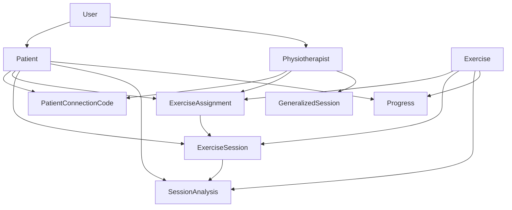
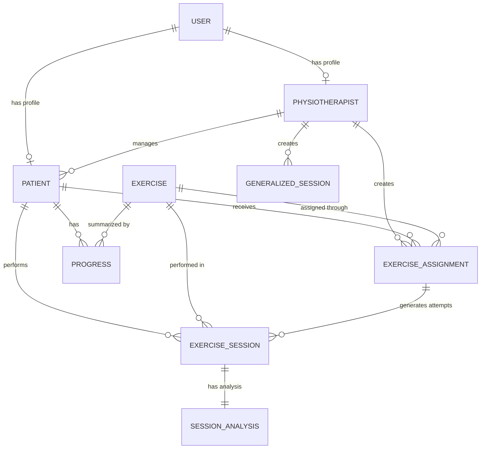
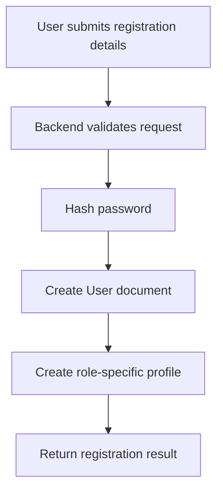
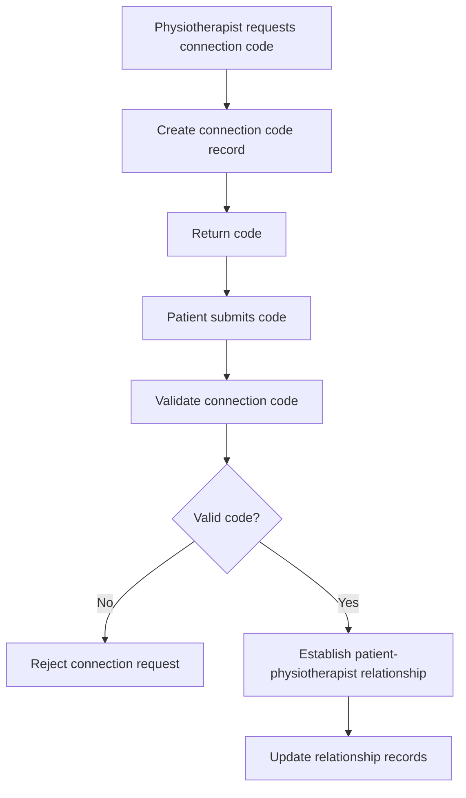
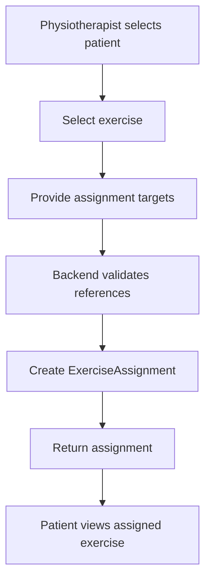
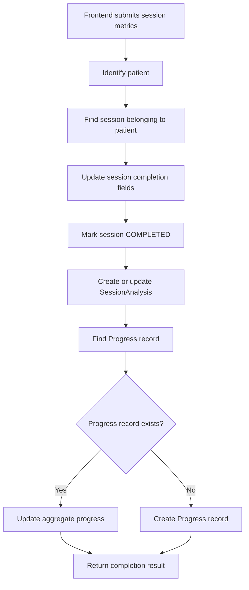
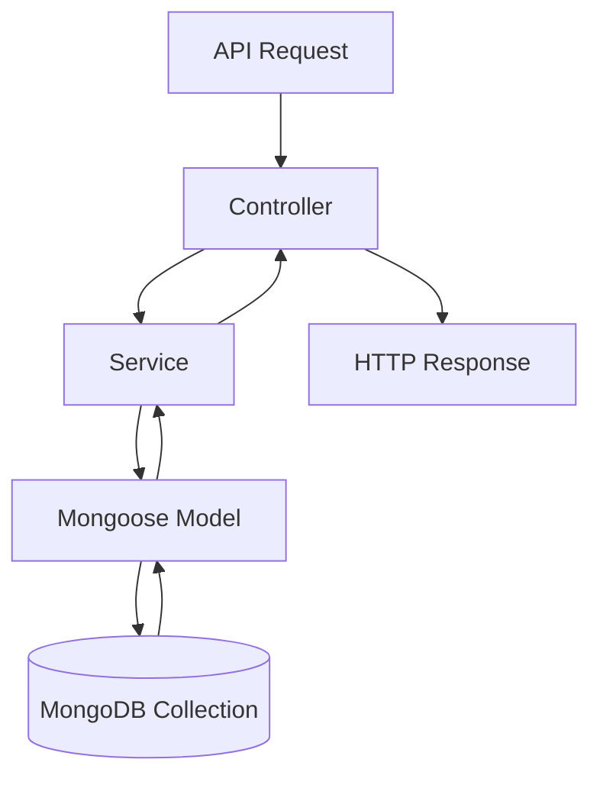

# Database Design

## 1. Introduction

PhysioVision uses MongoDB as its primary database and Mongoose as the Object Data Modeling (ODM) library for defining schemas and interacting with stored documents.

The database is designed around the application's main entities:

- Users
- Patients
- Physiotherapists
- Patient connection codes
- Exercises
- Exercise assignments
- Exercise sessions
- Session analysis
- Patient progress
- Generalized exercise sessions

The data model separates user account information from role-specific profile information. It also maintains separate records for exercise definitions, patient assignments, individual exercise attempts, session analysis, and aggregated progress.

This separation allows the application to manage exercise assignments independently from the actual sessions performed by patients.

## 2. Database Technology

| Technology | Responsibility                            |
| ---------- | ----------------------------------------- |
| MongoDB    | Document-oriented database                |
| Mongoose   | Schema definition and database operations |
| Node.js    | Backend runtime interacting with MongoDB  |

MongoDB stores application information as documents inside collections.

Mongoose provides the application-level structure for these documents through schemas and models.

The frontend does not communicate directly with MongoDB. All database operations are performed through the backend.

## 3. Database Architecture

The backend uses Mongoose models to represent the application's main entities.



The diagram represents the logical relationships between the major entities. The exact field names, reference definitions, and cardinalities are determined by the individual Mongoose schemas.

## 4. Database Models

The backend contains the following primary Mongoose models.

| Model                   | Purpose                                             |
| ----------------------- | --------------------------------------------------- |
| `User`                  | Stores account and authentication information       |
| `Patient`               | Stores patient-specific profile information         |
| `Physiotherapist`       | Stores physiotherapist-specific profile information |
| `PatientConnectionCode` | Manages patient connection codes                    |
| `Exercise`              | Stores exercise definitions and configurations      |
| `ExerciseAssignment`    | Represents exercises assigned to patients           |
| `ExerciseSession`       | Stores individual exercise attempts                 |
| `SessionAnalysis`       | Stores analysis results for completed sessions      |
| `Progress`              | Maintains aggregated patient exercise progress      |
| `GeneralizedSession`    | Stores generalized exercise session information     |

## 5. Entity Design

### 5.1 User

**Model:** `User.js`

The User model represents the primary account identity within PhysioVision.

It stores the common account information required for authentication and user identification.

Key data includes:

| Attribute     | Description                             |
| ------------- | --------------------------------------- |
| Name          | User's name                             |
| Email         | User's email address                    |
| Password hash | Hashed password used for authentication |
| Role          | Identifies the user's application role  |

The documented user roles include:

- `PATIENT`
- `PHYSIO`
- `ADMIN`

The role determines which application workflows and backend operations are available to the user.

The User model is separated from Patient and Physiotherapist profiles so that account identity and role-specific information can be maintained independently.

Passwords are stored as bcrypt hashes rather than plain-text values.

### 5.2 Patient

**Model:** `Patient.js`

The Patient model stores information specific to a patient account.

It connects a patient profile with the corresponding User account and maintains the relationship with the patient's physiotherapist.

Key relationships include:

| Attribute                 | Description                                   |
| ------------------------- | --------------------------------------------- |
| User reference            | Links the patient profile to its User account |
| Physiotherapist reference | Represents the linked physiotherapist         |

The Patient model is used by backend services to identify the patient associated with an authenticated user.

For example, when a patient starts an exercise session, the backend resolves the patient's profile before validating the requested assignment.

### 5.3 Physiotherapist

**Model:** `Physiotherapist.js`

The Physiotherapist model stores information specific to a physiotherapist account.

It connects the physiotherapist profile with the corresponding User account and maintains the collection of linked patients.

Key relationships include:

| Attribute      | Description                                                 |
| -------------- | ----------------------------------------------------------- |
| User reference | Links the physiotherapist profile to its User account       |
| Patients       | Represents the patients associated with the physiotherapist |

The model supports patient management, exercise assignment, and patient progress retrieval.

The backend uses this relationship when checking whether a physiotherapist is authorized to access a patient's information.

### 5.4 PatientConnectionCode

**Model:** `PatientConnectionCode.js`

The PatientConnectionCode model supports the workflow through which patients connect with physiotherapists.

A physiotherapist generates a connection code, and a patient submits that code to establish a relationship.

The model is responsible for maintaining the information required by this connection workflow.

The exact stored attributes, expiration rules, uniqueness constraints, and code lifecycle should be verified against the current Mongoose schema.

### 5.5 Exercise

**Model:** `Exercise.js`

The Exercise model represents an exercise available within PhysioVision.

It stores the information required to describe an exercise and configure its tracking behavior.

Documented data includes:

| Attribute          | Description                                                       |
| ------------------ | ----------------------------------------------------------------- |
| Name               | Exercise name                                                     |
| Description        | Exercise description                                              |
| Reference media    | References to exercise images or videos                           |
| Configuration      | Exercise-specific tracking configuration                          |
| Creator            | Reference to the user or physiotherapist who created the exercise |
| Custom flag        | Indicates whether the exercise is custom-created                  |
| Category           | Exercise category, where supported                                |
| Tracking mode      | Identifies the supported tracking mode                            |
| Static-pose fields | Configuration for supported static exercises                      |

An exercise definition is separate from an exercise assignment.

The Exercise model describes the activity, while ExerciseAssignment determines which patient is expected to perform it.

Reference images and videos are stored using Cloudinary. MongoDB stores the associated exercise information and media references.

### 5.6 ExerciseAssignment

**Model:** `ExerciseAssignment.js`

The ExerciseAssignment model represents an exercise assigned to a patient by a physiotherapist.

It connects the patient, physiotherapist, and exercise.

Documented attributes include:

| Attribute          | Description                                |
| ------------------ | ------------------------------------------ |
| Patient            | Reference to the assigned patient          |
| Physiotherapist    | Reference to the assigning physiotherapist |
| Exercise           | Reference to the assigned exercise         |
| Sets               | Number of prescribed sets, where supported |
| Target repetitions | Target repetition count                    |
| Status             | Current assignment state                   |
| Notes              | Additional assignment information          |

The assignment status represents the state of the prescribed exercise workflow.

Documented status values include:

- `ASSIGNED`
- `IN_PROGRESS`
- `COMPLETED`
- `PAUSED`

The exact enum values should be confirmed against the current schema implementation.

An assignment is not the same as an exercise session.

An assignment represents what a patient is expected to perform. An exercise session represents an individual attempt to perform that exercise.

This separation allows multiple sessions to be associated with the same assignment.

### 5.7 ExerciseSession

**Model:** `ExerciseSession.js`

The ExerciseSession model stores an individual exercise attempt performed by a patient.

It maintains the relationship between the patient, exercise, and optional assignment.

Documented attributes include:

| Attribute             | Description                                      |
| --------------------- | ------------------------------------------------ |
| Patient               | Reference to the patient performing the exercise |
| Exercise              | Reference to the exercise being performed        |
| Assignment            | Optional reference to the related assignment     |
| Started at            | Timestamp indicating when the session started    |
| Completed at          | Timestamp indicating when the session completed  |
| Duration              | Total session duration                           |
| Target repetitions    | Target repetition count                          |
| Completed repetitions | Actual completed repetition count                |
| Average score         | Average performance score                        |
| Repetition scores     | Scores associated with individual repetitions    |
| Status                | Current session state                            |

The session service creates an ExerciseSession when a patient starts an assigned exercise.

The creation workflow stores:

- Patient reference.
- Exercise reference.
- Assignment reference.
- Start timestamp.
- Target repetitions.

The assignment status is updated to `IN_PROGRESS`.

When the patient completes the exercise, the backend updates the session with the completion information and calculated metrics received from the frontend.

The documented session lifecycle includes:

- `IN_PROGRESS`
- `COMPLETED`

Other states, such as `ABANDONED`, should only be documented as supported if confirmed in the current schema.

### 5.8 SessionAnalysis

**Model:** `SessionAnalysis.js`

The SessionAnalysis model stores the performance analysis associated with an exercise session.

It separates the analysis information from the main session lifecycle record.

The verified schema fields include:

| Field             | Data Type | Description                                    |
| ----------------- | --------- | ---------------------------------------------- |
| `session`         | ObjectId  | Reference to the associated ExerciseSession    |
| `patient`         | ObjectId  | Reference to the Patient                       |
| `exercise`        | ObjectId  | Reference to the Exercise                      |
| `accuracy`        | Number    | Accuracy score, default 0                      |
| `formConsistency` | Number    | Form consistency score, default 0              |
| `completedReps`   | Number    | Number of completed repetitions, default 0     |
| `averageRepScore` | Number    | Average repetition score, default 0            |
| `summary`         | String    | Session analysis summary, default empty string |

Important schema properties:

- `session` is required.
- `patient` is required.
- `exercise` is required.
- `session` has a unique constraint.
- The schema uses Mongoose timestamps.

The unique session reference ensures that the analysis collection maintains a single analysis document for each session under the implemented persistence rule.

#### Session Analysis Persistence

The session completion service uses an upsert operation to create or update the analysis record.

Conceptually, the operation follows this pattern:

```javascript
SessionAnalysis.findOneAndUpdate(
    { session: session._id },
    {
        patient: patient._id,
        exercise: session.exercise,
        accuracy,
        formConsistency,
        completedReps,
        averageRepScore,
        summary,
    },
    {
        upsert: true,
        new: true,
    },
);
```

This allows the backend to create the analysis document when it does not exist or update it when a corresponding document is already present.

### 5.9 Progress

**Model:** `Progress.js`

The Progress model stores aggregated exercise progress for an individual patient.

Instead of relying only on individual session records, the application maintains progress information associated with a patient and exercise.

Documented information includes:

| Attribute              | Description                               |
| ---------------------- | ----------------------------------------- |
| Patient                | Reference to the patient                  |
| Exercise               | Reference to the exercise                 |
| Total sessions         | Number of recorded sessions               |
| Total repetitions      | Aggregated completed repetitions          |
| Average accuracy       | Average accuracy across relevant sessions |
| Latest accuracy        | Accuracy from the latest relevant session |
| Trend                  | Progress trend information                |
| Last session timestamp | Timestamp of the latest session           |

The model notes describe a unique patient–exercise pair.

This means the intended logical structure is one aggregated progress record for each patient and exercise combination.

#### Progress Update Workflow

When an exercise session is completed:

1. The backend identifies the patient.
2. The backend identifies the exercise associated with the session.
3. The progress service searches for an existing record for that patient and exercise.
4. If a record exists, its aggregate values are updated.
5. If no record exists, a new progress record is created.
6. The updated progress information becomes available through the progress APIs.

This approach provides a summarized view of patient performance across multiple exercise sessions.

### 5.10 GeneralizedSession

**Model:** `GeneralizedSession.js`

The GeneralizedSession model supports the generalized exercise session workflow.

It stores information about sessions created by physiotherapists and supports the invitation-based joining process.

The associated backend functionality includes:

- Creating generalized sessions.
- Retrieving sessions created by a physiotherapist.
- Updating session status.
- Retrieving session information using an invite code.
- Processing participant join requests.

The exact schema fields, participant representation, invitation constraints, and password-handling implementation should be verified against the current `GeneralizedSession.js` model before documenting them as exact database attributes.

## 6. Entity Relationships

The following relationships describe the logical data model.

| Parent Entity      | Related Entity     | Relationship | Description                                                                        |
| ------------------ | ------------------ | ------------ | ---------------------------------------------------------------------------------- |
| User               | Patient            | One-to-one   | A patient profile belongs to a user account                                        |
| User               | Physiotherapist    | One-to-one   | A physiotherapist profile belongs to a user account                                |
| Physiotherapist    | Patient            | One-to-many  | A physiotherapist can manage multiple connected patients                           |
| Patient            | ExerciseAssignment | One-to-many  | A patient can receive multiple exercise assignments                                |
| Physiotherapist    | ExerciseAssignment | One-to-many  | A physiotherapist can create multiple assignments                                  |
| Exercise           | ExerciseAssignment | One-to-many  | An exercise can be assigned to multiple patients                                   |
| Patient            | ExerciseSession    | One-to-many  | A patient can perform multiple exercise sessions                                   |
| Exercise           | ExerciseSession    | One-to-many  | An exercise can be performed across multiple sessions                              |
| ExerciseAssignment | ExerciseSession    | One-to-many  | An assignment can be associated with multiple attempts                             |
| ExerciseSession    | SessionAnalysis    | One-to-one   | A session has one associated analysis record under the current unique-session rule |
| Patient            | Progress           | One-to-many  | A patient can have progress records for multiple exercises                         |
| Exercise           | Progress           | One-to-many  | An exercise can have progress records for multiple patients                        |
| Physiotherapist    | GeneralizedSession | One-to-many  | A physiotherapist can create multiple generalized sessions                         |

These relationships describe the logical data model. The actual MongoDB implementation uses document references where defined by the Mongoose schemas.

## 7. Entity Relationship Diagram



## 8. Important Data Relationships

### 8.1 User and Role-Specific Profiles

The User model stores common account information.

Patient and Physiotherapist models store role-specific information.

This separation avoids placing all patient and physiotherapist attributes inside a single user document.

The backend resolves the corresponding profile based on the authenticated user's identity and role.

### 8.2 Patient and Physiotherapist Relationship

A patient is associated with a physiotherapist through the application's connection workflow.

The relationship is important because it determines which physiotherapist can manage a patient's assignments and access their progress information.

The backend verifies this relationship when retrieving protected patient information.

### 8.3 Exercise and Assignment Relationship

An Exercise describes an activity.

An ExerciseAssignment connects that exercise to a patient and a physiotherapist.

For example, the same exercise can be assigned to multiple patients, with each assignment maintaining its own target and status.

### 8.4 Assignment and Session Relationship

An assignment represents a prescribed activity.

A session represents an actual attempt by a patient to perform that activity.

Keeping these entities separate allows the application to maintain multiple attempts associated with the same assignment.

It also allows the application to preserve exercise history independently from the current assignment state.

### 8.5 Session and Analysis Relationship

ExerciseSession stores the lifecycle and execution information.

SessionAnalysis stores the corresponding performance analysis.

The session reference in SessionAnalysis is unique, and the session completion service uses an upsert operation to persist the analysis.

### 8.6 Patient and Progress Relationship

Progress stores aggregated information for a patient and exercise combination.

Individual ExerciseSession documents preserve the session history, while Progress provides a summarized view across sessions.

This supports efficient retrieval of exercise progress without requiring every dashboard request to calculate all historical metrics from scratch.

## 9. Database Workflows

### 9.1 User Registration



The registration workflow creates the user account and the relevant role-specific profile.

The password is hashed before being stored.

The exact profile creation behavior and transaction handling should be verified against the current authentication service implementation.

### 9.2 Patient Connection



The connection workflow establishes the relationship used by patient management and authorization operations.

### 9.3 Exercise Assignment



The backend validates the relevant patient and exercise references before creating the assignment.

### 9.4 Exercise Session Creation

The session service creates an ExerciseSession using the authenticated patient's profile and the requested assignment.

The core operation follows this sequence:

1. Find the Patient record using the authenticated user's ID.
2. Find the requested ExerciseAssignment belonging to that patient.
3. Populate the associated exercise.
4. Create an ExerciseSession.
5. Set the session start timestamp.
6. Store the target repetition count.
7. Update the assignment status to `IN_PROGRESS`.
8. Return the created session.

The service validates assignment ownership before creating the session.

### 9.5 Exercise Session Completion



The completion workflow persists the metrics calculated by the frontend.

The backend updates the session, stores its analysis, and updates the corresponding progress record.

## 10. Data Integrity and Validation

Database integrity is important because the application maintains relationships between multiple entities.

The backend and Mongoose schemas should enforce the relevant validation rules.

### 10.1 Required References

Referenced records should exist before creating relationships or assignments.

Examples include:

- A patient must exist before creating an assignment for that patient.
- An exercise must exist before assigning it.
- An assignment must belong to the requesting patient before creating a session from it.
- A session must belong to the requesting patient before completing it.

### 10.2 Role and Relationship Validation

The backend must verify the authenticated user's role and relationship to the requested resource.

A patient should only access their own assignments, sessions, and progress.

A physiotherapist should only manage patients connected to that physiotherapist.

### 10.3 Unique Relationships

The documented data model includes the following uniqueness requirements:

- The `SessionAnalysis.session` reference is unique.
- The intended Progress relationship is unique for each patient–exercise pair.

The exact Mongoose index definitions should be checked in the corresponding model files.

### 10.4 Session Consistency

Session completion should update the session, analysis, and progress records consistently.

Repeated completion requests should not silently inflate aggregated progress totals.

The backend should also handle invalid session IDs and mismatched patient ownership.

### 10.5 Missing References

The application should handle deleted, missing, or unavailable referenced records gracefully.

A populated reference should not be assumed to exist without checking the result.

## 11. Database Access Through Mongoose

The backend uses Mongoose models to perform database operations.

The general interaction pattern is:



The service layer contains the business operations and uses Mongoose models to retrieve or update documents.

For example, the session service interacts with:

- `Patient`
- `ExerciseAssignment`
- `ExerciseSession`
- `SessionAnalysis`
- `Progress`

This keeps database operations organized around application workflows.

## 12. Example Data Structures

The following examples illustrate the logical shape of important records. They are documentation examples, not guaranteed verbatim MongoDB documents. Actual field names, defaults, generated identifiers, and optional fields must follow the current Mongoose schemas.

### 12.1 User Document

```json
{
    "_id": "USER_ID",
    "name": "Example User",
    "email": "user@example.com",
    "password": "BCRYPT_HASH",
    "role": "PATIENT"
}
```

### 12.2 Patient Document

```json
{
    "_id": "PATIENT_ID",
    "user": "USER_ID",
    "physiotherapist": "PHYSIOTHERAPIST_ID"
}
```

### 12.3 Exercise Document

```json
{
    "_id": "EXERCISE_ID",
    "name": "Shoulder Exercise",
    "description": "Example exercise description",
    "category": "Upper Body",
    "trackingMode": "DYNAMIC",
    "configuration": {},
    "isCustom": true,
    "createdBy": "USER_ID"
}
```

### 12.4 Exercise Assignment Document

```json
{
    "_id": "ASSIGNMENT_ID",
    "patient": "PATIENT_ID",
    "physiotherapist": "PHYSIOTHERAPIST_ID",
    "exercise": "EXERCISE_ID",
    "sets": 3,
    "targetReps": 10,
    "status": "ASSIGNED",
    "notes": "Example assignment notes"
}
```

### 12.5 Exercise Session Document

```json
{
    "_id": "SESSION_ID",
    "patient": "PATIENT_ID",
    "exercise": "EXERCISE_ID",
    "assignment": "ASSIGNMENT_ID",
    "startedAt": "2026-01-01T10:00:00.000Z",
    "completedAt": "2026-01-01T10:10:00.000Z",
    "duration": 600,
    "targetReps": 10,
    "completedReps": 10,
    "averageScore": 85,
    "repScores": [],
    "status": "COMPLETED"
}
```

### 12.6 Session Analysis Document

```json
{
    "_id": "ANALYSIS_ID",
    "session": "SESSION_ID",
    "patient": "PATIENT_ID",
    "exercise": "EXERCISE_ID",
    "accuracy": 85,
    "formConsistency": 90,
    "completedReps": 10,
    "averageRepScore": 85,
    "summary": "Example session analysis",
    "createdAt": "2026-01-01T10:10:00.000Z",
    "updatedAt": "2026-01-01T10:10:00.000Z"
}
```

### 12.7 Progress Document

```json
{
    "_id": "PROGRESS_ID",
    "patient": "PATIENT_ID",
    "exercise": "EXERCISE_ID",
    "totalSessions": 5,
    "totalReps": 50,
    "averageAccuracy": 85,
    "latestAccuracy": 90,
    "trend": [],
    "lastSessionAt": "2026-01-01T10:10:00.000Z"
}
```

### 12.8 Generalized Session Document

```json
{
    "_id": "GENERALIZED_SESSION_ID",
    "physiotherapist": "PHYSIOTHERAPIST_ID",
    "inviteCode": "INVITE_CODE",
    "status": "ACTIVE"
}
```

The generalized session example is intentionally illustrative. The exact schema, including participant data, invitation credentials, and other session properties, must be taken from the current `GeneralizedSession.js` implementation.

## 13. Database Design Decisions

### 13.1 Separate User and Profile Models

User account information is separated from patient and physiotherapist profile information.

This keeps authentication-related data independent from role-specific application data.

### 13.2 Separate Exercise and Assignment Models

An exercise represents a reusable activity.

An assignment represents the relationship between an exercise, a patient, and a physiotherapist.

This allows the same exercise to be assigned to multiple patients with different targets.

### 13.3 Separate Assignment and Session Models

An assignment represents the prescribed exercise.

A session represents an actual attempt.

This distinction allows the application to preserve multiple attempts and maintain an exercise history.

### 13.4 Separate Session Analysis

Session performance information is stored separately from the main session record.

This separates session lifecycle management from the analysis generated after exercise completion.

### 13.5 Aggregated Progress Records

Progress records summarize performance across multiple sessions.

This avoids requiring every progress view to reconstruct all aggregate information from the complete session history.

### 13.6 External Media Storage

Exercise reference images and videos are stored using Cloudinary.

MongoDB stores the exercise information and associated media references rather than the actual media files.

## 14. Summary

PhysioVision uses MongoDB and Mongoose to maintain its application data.

The database separates user accounts, role-specific profiles, exercises, assignments, sessions, analysis, and aggregated progress into distinct models.

The most important relationships are:

- User accounts connect to patient or physiotherapist profiles.
- Physiotherapists manage connected patients.
- Exercise assignments connect patients, physiotherapists, and exercises.
- Exercise sessions record individual attempts.
- Session analysis stores performance information associated with completed sessions.
- Progress records summarize performance for each patient and exercise.
- Generalized sessions support invitation-based exercise participation.

The separation between assignments, sessions, analysis, and progress is particularly important. It allows PhysioVision to preserve the difference between what a patient is expected to perform, what the patient actually performed, how that performance was evaluated, and how their performance changes over time.

The exact schema definitions, validation rules, indexes, defaults, and enum values should always be treated as authoritative in the corresponding Mongoose model files.
