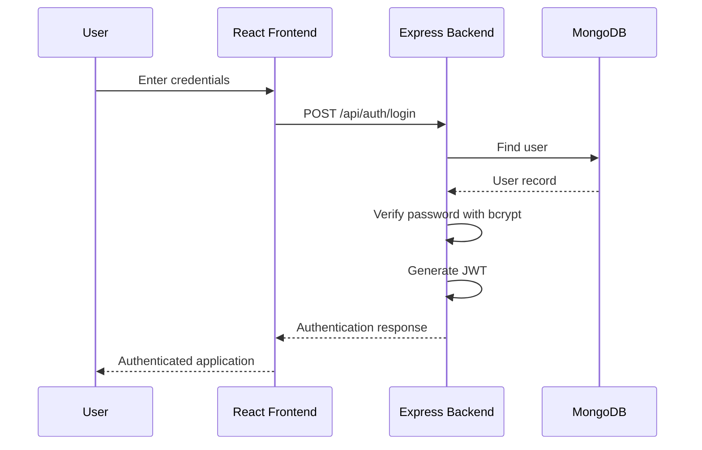
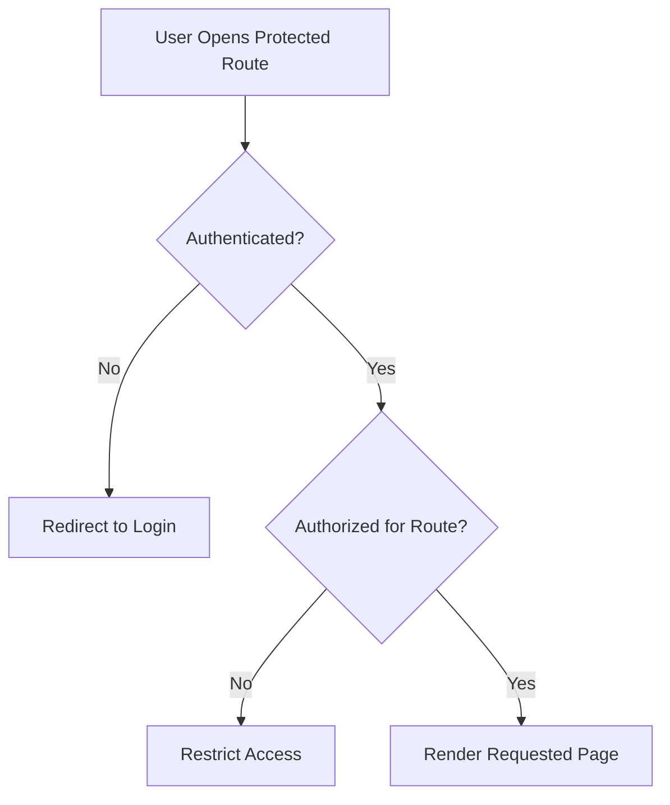

# Authentication and Security

## 1. Introduction

PhysioVision uses an authentication and authorization system to protect
application resources and provide role-specific access to patients and
physiotherapists.

The backend implements authentication using **JSON Web Tokens (JWT)**
and password hashing using **bcrypt**.

The authentication system is integrated with the React frontend through
a centralized authentication context and protected routes.

The main responsibilities are:

- User registration and login.
- Secure password storage.
- Token-based authentication.
- Authenticated API requests.
- Role-based access to application functionality.
- Protection of patient, physiotherapist, exercise, and session
  resources.

---

## 2. Authentication Architecture

Authentication is divided between the frontend and backend.

### 2.1 Frontend

Relevant files:

```text
frontend/src/
├── context/
│   └── AuthContext.jsx
├── components/
│   └── ProtectedRoute.jsx
├── pages/
│   ├── Login.jsx
│   └── Register.jsx
└── services/
    └── api.js
```

Responsibilities:

- Collect login and registration information.
- Maintain authentication state.
- Provide authenticated application context.
- Protect routes that require authentication.
- Attach authentication information to API requests.

### 2.2 Backend

Relevant files:

```text
backend/src/
├── middleware/
│   └── auth.js
├── modules/
│   └── auth/
│       ├── auth.controller.js
│       ├── auth.routes.js
│       └── auth.service.js
└── models/
    └── User.js
```

Responsibilities:

- Validate registration and login requests.
- Hash passwords before storing them.
- Verify credentials during login.
- Generate authentication tokens.
- Validate tokens for protected API requests.
- Make authenticated user information available to backend
  controllers.

---

## 3. Registration Workflow

New users can register through the frontend registration page.

**Frontend:** `frontend/src/pages/Register.jsx`

**Backend endpoint:**

```http
POST /api/auth/register
```

### Workflow

1.  The user opens the registration page.
2.  The frontend collects the required registration information.
3.  The registration request is sent to the backend.
4.  The backend validates the submitted information.
5.  The password is hashed using bcrypt.
6.  A user record is created in MongoDB.
7.  The frontend handles the registration response.

### Password Storage

Passwords should never be stored as plain text.

PhysioVision uses bcrypt to hash passwords before persistence.

Conceptually:

```text
User Password
      |
      v
Backend Registration
      |
      v
bcrypt Password Hashing
      |
      v
MongoDB User Record
```

The stored password hash is used for subsequent credential verification.

---

## 4. Login Workflow

Existing users authenticate through the login page.

**Frontend:** `frontend/src/pages/Login.jsx`

**Backend endpoint:**

```http
POST /api/auth/login
```

### Workflow

1.  The user submits their login credentials.
2.  The frontend sends the login request.
3.  The backend retrieves the corresponding user.
4.  The submitted password is verified against the stored bcrypt hash.
5.  If authentication succeeds, the backend generates a JWT.
6.  The frontend processes the authentication response.
7.  The authenticated user can access the application according to their
    role and permissions.

### Authentication Flow



---

## 5. JSON Web Token Authentication

PhysioVision uses JWT for authenticated API communication.

A JWT allows the backend to identify an authenticated user when the
frontend makes subsequent requests.

### 5.1 Token Lifecycle

```text
Login Request
     |
     v
Credential Verification
     |
     v
JWT Generation
     |
     v
Frontend Receives Token
     |
     v
Authenticated API Requests
     |
     v
Backend Token Verification
     |
     v
Authorized Request Processing
```

### 5.2 Authenticated Requests

The frontend API service is responsible for centralizing API
communication.

**File:** `frontend/src/services/api.js`

For protected endpoints, the frontend must provide the authentication
information expected by the backend.

The backend authentication middleware validates the supplied token
before allowing the request to proceed.

### 5.3 Token Verification

**File:** `backend/src/middleware/auth.js`

The authentication middleware acts as a security boundary between
incoming requests and protected application routes.

Its responsibilities include:

1.  Reading the authentication information from the request.
2.  Validating the JWT.
3.  Identifying the authenticated user.
4.  Rejecting requests with invalid or missing authentication.
5.  Allowing valid authenticated requests to continue.

The exact token payload, expiration settings, and token storage
mechanism should be verified against the current implementation before
being documented as fixed configuration.

---

## 6. Current User Information

The backend exposes an endpoint for retrieving the authenticated user's
information.

```http
GET /api/auth/me
```

This endpoint allows the frontend to retrieve the current authenticated
user context.

The frontend maintains authentication state through:

```text
frontend/src/context/AuthContext.jsx
```

The authentication context helps make user information and
authentication-related functionality available across React components.

This avoids requiring every page to independently implement
authentication-state management.

---

## 7. Protected Routes

PhysioVision uses a protected-route component:

```text
frontend/src/components/ProtectedRoute.jsx
```

Protected routes prevent unauthenticated users from directly accessing
application pages that require authentication.

### Conceptual Workflow



Authentication and authorization are separate concepts:

- **Authentication:** Determines whether the user has a valid
  identity.
- **Authorization:** Determines whether that identity is permitted to
  perform a particular operation.

Frontend route protection improves application navigation and user
experience. Backend authorization remains necessary because frontend
restrictions alone cannot secure API resources.

---

## 8. Role-Based Access

PhysioVision provides different application experiences for patients and
physiotherapists.

### 8.1 Patient

Patient functionality includes:

- Viewing the patient dashboard.
- Viewing assigned exercises.
- Starting exercise sessions.
- Completing exercise sessions.
- Viewing personal progress and session history.
- Connecting with a physiotherapist.

### 8.2 Physiotherapist

Physiotherapist functionality includes:

- Viewing connected patients.
- Managing patient connections.
- Creating exercises.
- Assigning exercises to patients.
- Reviewing patient progress.
- Managing supported generalized exercise sessions.

The application uses role information to provide the appropriate
frontend experience.

Backend services must also verify resource ownership and access
permissions before returning or modifying protected data.

---

## 9. Resource-Level Authorization

Authentication alone does not guarantee access to every resource.

For example, a patient should not be able to access another patient's
private session history merely because they have a valid JWT.

PhysioVision includes application-level access checks in its backend
workflows.

### 9.1 Patient and Physiotherapist Relationships

The patient and physiotherapist relationship is maintained through the
application's connection functionality.

Relevant endpoints include:

```http
GET  /api/physio/patients
POST /api/connections/code
POST /api/connections/connect
GET  /api/connections/mine
```

These endpoints support the patient-physiotherapist connection workflow.

### 9.2 Session Authorization

The session workflow associates exercise sessions with the corresponding
patient and exercise assignment.

The backend verifies that the assignment belongs to the patient when
creating a session.

This prevents a patient from starting a session using an assignment that
belongs to another patient.

### 9.3 Progress Authorization

The progress service performs access checks using the
patient-physiotherapist relationship.

Access is evaluated using the relationship represented in the patient
and physiotherapist records.

This helps ensure that progress information is accessed through the
appropriate application relationship.

---

## 10. Authentication-Related API Reference

---

Method Endpoint Purpose

---

POST `/api/auth/register` Register a new user.

POST `/api/auth/login` Authenticate an
existing user.

GET `/api/auth/me` Retrieve the
authenticated user's
information.

---

### Related Connection Endpoints

---

Method Endpoint Purpose

---

GET `/api/physio/patients` Retrieve patients
associated with a
physiotherapist.

POST `/api/connections/code` Generate a
patient-physiotherapist
connection code.

POST `/api/connections/connect` Connect a patient and
physiotherapist.

GET `/api/connections/mine` Retrieve the current
user's connection
information.

---

---

## 11. Security Considerations

### 11.1 Password Hashing

Passwords are hashed using bcrypt before storage.

This prevents the database from storing users' original passwords.

### 11.2 JWT Validation

Protected backend routes rely on authentication middleware to validate
incoming authentication tokens.

Invalid or missing authentication should result in rejection of the
protected request.

### 11.3 Backend Authorization

Access control must be enforced by the backend rather than relying
exclusively on frontend route protection.

Resource-level checks are particularly important for patient sessions,
assignments, and progress information.

### 11.4 Environment Variables

Sensitive configuration should be stored in environment variables rather
than committed directly to source control.

The backend uses environment-based configuration for its deployment
dependencies and secrets.

The actual environment variable names and required values should be
taken from the backend configuration and deployment setup.

### 11.5 Transport Security

Production deployments should use HTTPS to protect credentials and
authentication tokens while they are transmitted between the frontend
and backend.

### 11.6 Error Handling

Authentication failures should return appropriate error responses
without exposing password hashes, JWT secrets, or other sensitive
implementation details.

---

## 12. Security Boundaries and Limitations

The authentication system provides the foundation for protecting
PhysioVision resources, but it should not be interpreted as a complete
security audit.

The following areas should be evaluated against the actual
implementation and deployment configuration:

- JWT expiration and renewal strategy.
- Token storage and protection against client-side script attacks.
- Login rate limiting.
- Account recovery and password reset functionality.
- Input validation and sanitization.
- CORS configuration.
- Request-level authorization across every protected endpoint.
- Production secret management.
- HTTPS enforcement.

These are security considerations and verification points, not claims
that every mechanism is already implemented.

---

## 13. Summary

PhysioVision uses JWT-based authentication and bcrypt password hashing
to manage user identity and protect application resources.

The frontend centralizes authentication state through `AuthContext.jsx`
and uses `ProtectedRoute.jsx` to control access to protected pages.

The backend implements authentication through the authentication module
and `auth.js` middleware.

Role-specific application experiences support patients and
physiotherapists, while backend resource-level checks protect patient
assignments, sessions, connections, and progress information.

This separation between authentication, frontend route protection, and
backend authorization provides the foundation for secure access to the
PhysioVision application.
