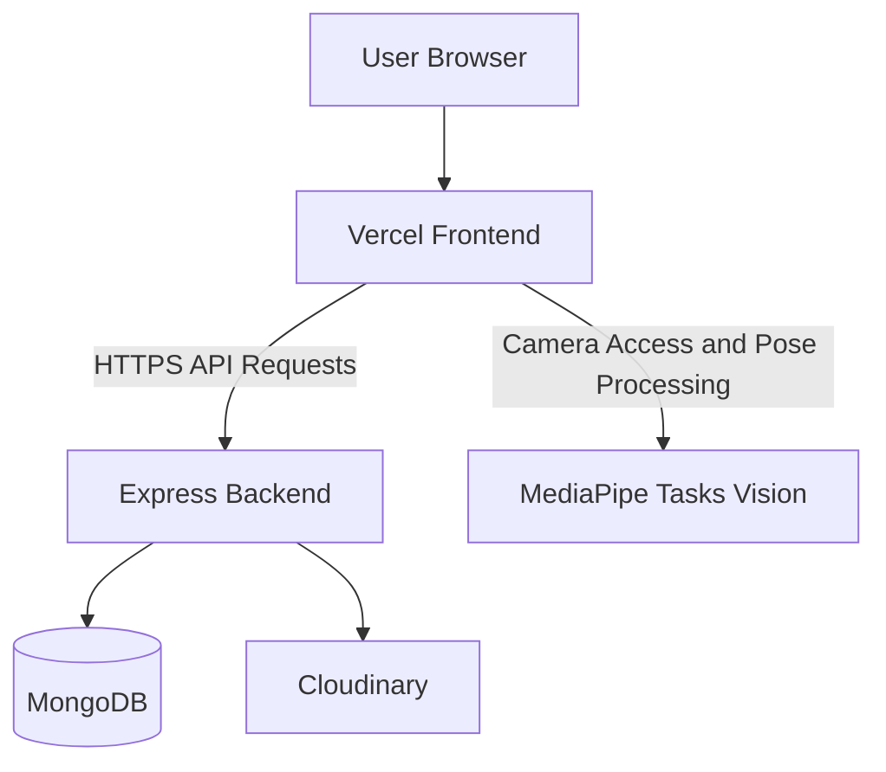

# Deployment Guide

## 1. Introduction

This document describes the deployment structure and operational
configuration of PhysioVision.

PhysioVision is a full-stack web application with:

- A React and Vite frontend.
- A Node.js and Express backend.
- MongoDB with Mongoose for data persistence.
- Cloudinary for exercise reference media.
- JWT-based authentication.

The frontend is deployed on Vercel:

**Frontend URL:** https://pvv-3.vercel.app/

**Repository:** https://github.com/viralbhoi/PVV3

The frontend and backend are separate application components. Their
deployment configuration must be maintained independently, while the
frontend must be configured to communicate with the deployed backend
API.

> Note: The frontend deployment URL is known. The exact production
> backend hosting provider, backend URL, environment variable names, and
> hosting-specific commands must be verified from the active deployment
> configuration before being treated as fixed values.

---

## 2. Deployment Architecture

The application follows a separated frontend-backend deployment model.



### Component responsibilities

---

Component Deployment responsibility

---

React + Vite frontend Serves the application interface
and runs browser-side pose
tracking.

Node.js + Express backend Exposes API endpoints and handles
application workflows.

MongoDB Stores users, exercises,
assignments, sessions, analysis,
and progress data.

Cloudinary Stores uploaded exercise reference
assets.

MediaPipe Tasks Vision Runs in the browser as part of the
pose-tracking workflow.

---

The browser communicates with the backend through HTTP API requests.
Camera-based pose processing is performed in the frontend rather than
being deployed as a separate backend service.

---

## 3. Repository Structure

The project repository is organized into separate frontend and backend
applications.

```text
PVV3/
├── backend/
│   ├── src/
│   │   ├── config/
│   │   ├── middleware/
│   │   ├── models/
│   │   ├── modules/
│   │   ├── utils/
│   │   ├── app.js
│   │   └── server.js
│   ├── package.json
│   └── package-lock.json
│
├── frontend/
│   ├── public/
│   ├── src/
│   ├── package.json
│   ├── vite.config.js
│   ├── vercel.json
│   └── README.md
│
└── .gitignore
```

The `frontend` and `backend` directories have their own dependencies and
runtime configuration.

---

## 4. Frontend Deployment on Vercel

The React application is built using Vite and deployed on Vercel.

**Production URL:** https://pvv-3.vercel.app/

### 4.1 Vercel Project Configuration

The Vercel project should use the frontend directory as its project
root.

Setting Value

---

Framework Vite
Root directory `frontend`
Build command `npm run build`
Output directory `dist`
Install command `npm install`

These are the expected settings for the current Vite frontend structure.
Confirm the values in the Vercel project settings if the deployment
configuration has changed.

### 4.2 Frontend Build

To build the frontend locally:

```bash
cd frontend
npm install
npm run build
```

Vite generates the production build in the `dist` directory.

The generated build is the static frontend output served by the
deployment platform.

### 4.3 Frontend Environment Configuration

The frontend needs to know the backend API base URL.

Configure the API URL using the environment variable expected by the
frontend API service.

The exact variable name should be checked in:

```text
frontend/src/services/api.js
```

Do not assume a variable name or production API URL without checking the
current source and Vercel environment settings.

After changing a Vercel environment variable, trigger a new deployment
so the updated value is included in the frontend build.

---

## 5. Client-Side Routing and Vercel Rewrites

PhysioVision uses React Router for frontend navigation.

In a single-page application, routes such as:

```text
/physio/generalized-sessions
/patient/dashboard
```

are handled by the React application rather than by separate physical
HTML files.

When a user directly opens or refreshes a nested route, the hosting
platform must serve the frontend entry point so React Router can resolve
the route.

### 5.1 Vercel Rewrite Configuration

The frontend contains a `vercel.json` file:

```json
{
    "rewrites": [
        {
            "source": "/(.*)",
            "destination": "/index.html"
        }
    ]
}
```

This rewrite directs incoming frontend paths to `index.html`.

React Router then determines which page should be rendered.

### 5.2 Deployment Issue and Resolution

A deployment issue was encountered when directly opening a nested route:

```text
/physio/generalized-sessions
```

Vercel returned a 404 because the request was not being served through
the single-page application entry point.

Adding the rewrite configuration resolved the routing issue. The
generalized session route and its join workflow subsequently worked on
the deployed frontend.

This configuration is important for direct navigation, refreshing nested
pages, and sharing application URLs.

---

## 6. Backend Deployment

The backend is a Node.js and Express application located in:

```text
backend/
```

Its entry-point files are:

```text
backend/src/app.js
backend/src/server.js
```

The backend is responsible for:

- Authentication.
- Patient and physiotherapist management.
- Exercise management.
- Exercise assignments.
- Exercise sessions.
- Generalized sessions.
- Progress and session analysis.
- Exercise reference asset uploads.

### 6.1 Backend Installation

From the repository root:

```bash
cd backend
npm install
```

### 6.2 Starting the Backend

The backend package scripts define the available runtime commands.

Inspect the scripts before starting the application:

```bash
npm run
```

Use the appropriate development or production script defined in
`backend/package.json`.

Do not assume a script name or production process manager without
checking the package configuration.

### 6.3 Backend Port and Hosting

The backend must listen on the port supplied by its deployment
environment when hosted on a platform that assigns a runtime port.

The exact backend hosting provider, public API URL, process
configuration, and health-check settings are deployment-specific and
should be recorded from the active hosting configuration.

---

## 7. Environment Variables and External Services

PhysioVision depends on external services that require configuration.

### 7.1 MongoDB

The backend uses MongoDB through Mongoose.

The database connection is configured in:

```text
backend/src/config/db.js
```

The deployment environment must provide the database connection
configuration expected by this module.

A production database should be reachable from the backend hosting
environment.

### 7.2 JWT Configuration

JWT authentication requires a signing secret or equivalent configuration
used by the backend authentication implementation.

The secret must be supplied securely through the backend environment.

It should not be committed to the repository or exposed through frontend
environment variables.

### 7.3 Cloudinary

Cloudinary is used to store exercise reference assets.

Relevant backend files:

```text
backend/src/config/cloudinary.js
backend/src/utils/uploadToCloudinary.js
backend/src/middleware/uploadExerciseAssets.js
```

The backend deployment must have the Cloudinary credentials and
configuration required by these modules.

### 7.4 Environment Configuration Checklist

Before deploying the backend, verify that the required environment
variables are configured for:

- MongoDB connection.
- JWT signing and verification.
- Cloudinary account configuration.
- Server port, if required by the hosting platform.
- Any additional service configuration referenced by the backend
  source.

The exact variable names should be taken from the configuration files
and environment examples in the repository. Do not copy secrets into
this documentation.

---

## 8. API Connectivity

The frontend communicates with the backend through the centralized API
service:

```text
frontend/src/services/api.js
```

The production frontend must use the deployed backend API base URL.

### Deployment checks

1.  Confirm that the backend is running and reachable.
2.  Confirm that the frontend API base URL points to the deployed
    backend.
3.  Confirm that the backend allows requests from the deployed frontend
    origin.
4.  Confirm that authentication requests work.
5.  Confirm that protected API requests include the expected
    authentication information.
6.  Confirm that file uploads reach the backend and Cloudinary.
7.  Confirm that session completion requests persist their results.

The backend exposes a health endpoint:

```http
GET /api/health
```

This endpoint can be used to check backend availability.

---

## 9. CORS and Cross-Origin Requests

Because the frontend and backend may be hosted on different origins, the
backend must be configured to accept requests from the frontend
deployment.

The backend CORS configuration should allow the deployed frontend origin
and the HTTP methods and headers required by the application.

At minimum, verify requests involving:

- Authentication.
- Exercise retrieval and creation.
- Patient connections.
- Exercise assignments.
- Session creation and completion.
- Progress retrieval.
- Exercise asset uploads.
- Generalized session operations.

Avoid using unrestricted production CORS settings unless they are
explicitly required and justified.

The exact CORS implementation should be verified in the backend
application configuration.

---

## 10. Deployment Verification Checklist

After deployment, verify the application in a real browser.

### 10.1 Frontend

- [ ] The Vercel deployment loads successfully.
- [ ] The homepage and login page render correctly.
- [ ] Registration and login pages work.
- [ ] Nested React Router routes load directly.
- [ ] Refreshing a nested route does not return a Vercel 404.
- [ ] Static assets load correctly.

### 10.2 Backend and Database

- [ ] The backend health endpoint responds.
- [ ] MongoDB connection succeeds.
- [ ] Registration creates a user.
- [ ] Login returns the expected authentication result.
- [ ] Protected API requests work.
- [ ] Patient and physiotherapist connection workflows work.
- [ ] Exercise retrieval and creation work.
- [ ] Exercise assignments can be created and retrieved.
- [ ] Session creation and completion work.
- [ ] Progress and session history are available.

### 10.3 External Services

- [ ] Cloudinary credentials are configured.
- [ ] Exercise reference image uploads work.
- [ ] Exercise reference video uploads work.
- [ ] Uploaded media can be retrieved by the frontend.

### 10.4 Pose Tracking

- [ ] The browser requests camera permission.
- [ ] Pose tracking initializes on a supported browser and device.
- [ ] Dynamic exercise tracking works.
- [ ] Static pose tracking works where enabled.
- [ ] Session metrics are submitted successfully.
- [ ] The completed session appears in the relevant history or
      progress view.

### 10.5 Generalized Sessions

- [ ] A physiotherapist can create a generalized session.
- [ ] The generated invite information is available.
- [ ] A participant can open the join page.
- [ ] The participant can complete the join workflow.
- [ ] The generalized session route works when opened directly or
      refreshed.

---

## 11. Common Deployment Issues

### 11.1 Vercel 404 on Nested Routes

**Symptom:** The root frontend works, but directly opening a nested
route returns 404.

**Cause:** The hosting platform is not forwarding the route to the React
application entry point.

**Resolution:** Verify the `frontend/vercel.json` rewrite configuration
and redeploy.

### 11.2 Frontend Cannot Reach the Backend

**Symptom:** The frontend loads, but API requests fail.

**Possible causes:**

- Incorrect frontend API base URL.
- Backend deployment is unavailable.
- Backend CORS configuration does not allow the frontend origin.
- Incorrect backend environment configuration.

**Resolution:** Check the API base URL, backend health endpoint, browser
network requests, and backend logs.

### 11.3 Database Connection Failure

**Symptom:** Backend starts but database-backed requests fail.

**Possible causes:**

- Incorrect MongoDB connection configuration.
- Database service unavailable.
- Network access restrictions.
- Invalid database credentials.

**Resolution:** Verify the database configuration and connectivity from
the backend hosting environment.

### 11.4 Authentication Failure After Deployment

**Symptom:** Login or protected requests fail in production.

**Possible causes:**

- Missing or inconsistent JWT configuration.
- Frontend and backend authentication contract mismatch.
- Authentication information not being attached to requests.
- Incorrect frontend API configuration.

**Resolution:** Inspect the login response, browser network requests,
backend authentication middleware, and production environment
configuration.

### 11.5 Camera Access Failure

**Symptom:** Pose tracking cannot initialize in the deployed
application.

**Possible causes:**

- Camera permission denied.
- Unsupported browser or device.
- Camera already in use.
- Insecure context or browser permission restrictions.

**Resolution:** Verify browser camera permissions, use the deployed
HTTPS application, and test on a supported browser and device.

---

## 12. Production Security and Operational Practices

The following practices should be followed when maintaining the deployed
application:

1.  Keep database credentials, JWT secrets, and Cloudinary credentials
    in backend environment variables.
2.  Never commit `.env` files containing secrets.
3.  Use HTTPS for production frontend and backend communication.
4.  Restrict database access to trusted services where possible.
5.  Configure CORS for the intended frontend origin.
6.  Avoid exposing backend secrets through Vite environment variables.
7.  Review deployment logs for runtime errors without logging passwords,
    tokens, or sensitive user information.
8.  Verify database connectivity and external service configuration
    after changing deployment settings.
9.  Redeploy the frontend after changing build-time environment
    variables.
10. Test authentication, uploads, exercise sessions, and nested routes
    after production changes.

---

## 13. Summary

PhysioVision uses a separated deployment architecture in which the React
and Vite frontend is hosted on Vercel and communicates with a Node.js
and Express backend.

MongoDB provides persistent storage, while Cloudinary handles exercise
reference assets. MediaPipe Tasks Vision runs in the browser as part of
the client-side pose tracking workflow.

The Vercel rewrite configuration is important because the application
uses React Router and must support direct access to nested frontend
routes.

A successful deployment depends on correct frontend API configuration,
backend environment variables, database connectivity, Cloudinary
configuration, CORS settings, and verification of the complete patient
and physiotherapist workflows.

The exact backend hosting provider and production configuration should
be maintained from the active deployment settings rather than inferred
from the frontend deployment.
